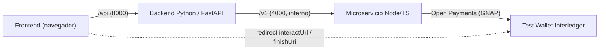
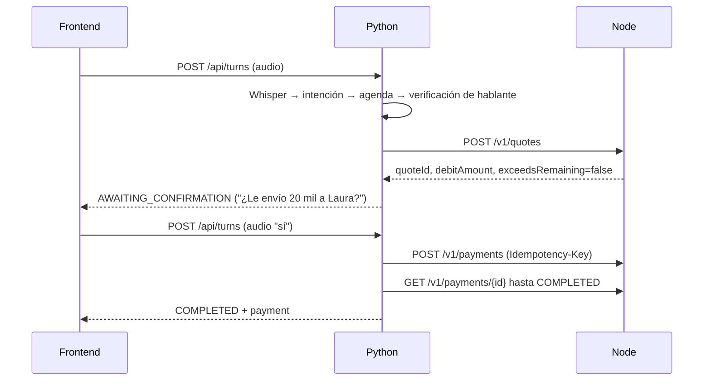
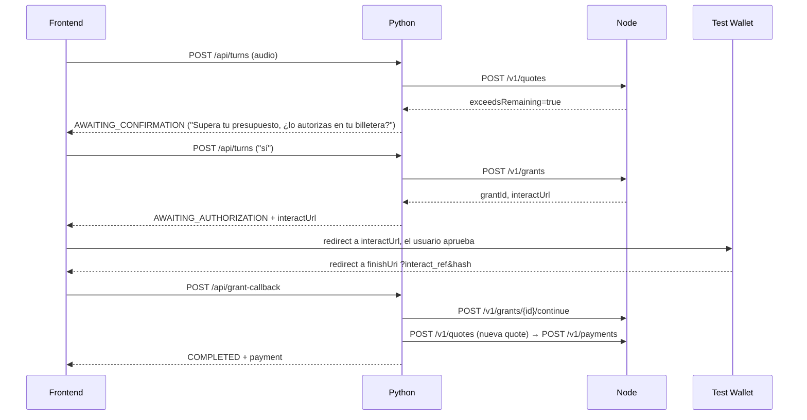

# Contratos HTTP v1

> **Vigente con los cambios de v1.1** ([`contratos-cambios-propuestos-v1.1.md`](./contratos-cambios-propuestos-v1.1.md)),
> ratificados el 16 de octubre. Si este documento y v1.1 chocan, gana v1.1.

Anexo del [Spec general](../docs/spec-general.md). Los contratos son **decisión del
equipo**: los acordaron los cuatro, y cualquier cambio necesita el OK de los cuatro.

Fuente de verdad para que los 4 trabajen en paralelo el viernes. Cada servicio se  
desarrolla contra un **mock** del servicio del que depende, generado desde estos  
contratos.



## Decisiones


| Decisión                                 | Elección                                                                                           | Motivo                                                                                            |
| ---------------------------------------- | -------------------------------------------------------------------------------------------------- | ------------------------------------------------------------------------------------------------- |
| Estado del grant                         | **Node con estado.** Guarda access token, continue token/URI y nonce. Python solo conoce `grantId` | Los secretos de Open Payments nunca salen de Node; contrato pequeño                               |
| Retorno de la autorización (`finishUri`) | **Al frontend**, que reenvía `interact_ref` + `hash` a Python, y Python a Node                     | El frontend solo habla con Python; Python reanuda el pago pendiente de inmediato                  |
| Pago                                     | **Dos pasos:** quote y luego payment                                                               | La confirmación hablada usa el monto real debitado; el exceso de límite se detecta antes del "sí" |
| Montos                                   | Forma de Open Payments: `{value: string, assetCode, assetScale}`                                   | Sin floats con dinero                                                                             |
| Semántica del monto hablado              | `receiveAmount` (lo que recibe el destinatario)                                                    | "Envíale 20 mil" = le llegan 20 mil                                                               |
| Contabilidad del presupuesto             | Node calcula `spent` / `remaining`                                                                 | Es quien ve los outgoing payments                                                                 |
| Idempotencia                             | Header `Idempotency-Key` en `POST /v1/payments`                                                    | Un reintento nunca paga dos veces                                                                 |
| TTS                                      | Navegador (Web Speech API); Python devuelve texto en `say`                                         | Contrato simple; se puede cambiar sin tocar Python                                                |
| Entrada de comandos                      | Un solo `/api/turns` acepta `audio` **o** `text`                                                   | H1 (texto) y H2 (voz) usan el mismo endpoint                                                      |
| Usuarios                                 | Uno solo en el MVP (`userId` fijo)                                                                 | Multiusuario no suma en el pitch                                                                  |


## Tipos compartidos

```ts
type Amount = { value: string; assetCode: string; assetScale: number }
// ej. 20.000 COP con escala 2 → { value: "2000000", assetCode: "COP", assetScale: 2 }

type ErrorBody = { error: { code: string; message: string } }
// Se decide siempre por `code`, nunca por `message`.
```

`value` es siempre un string de solo dígitos (`^\d+$`): sin decimales, signo ni separadores.
Node responde `400 INVALID_AMOUNT` a cualquier otra cosa. Convertir el texto hablado ("20 mil",
"10.50") a `Amount` es responsabilidad de Python, que rechaza los decimales que sobran
(`TOO_MANY_DECIMALS`) y nunca redondea.

Todos los endpoints de Node pueden responder `500 INTERNAL_ERROR` ante un error no previsto.
Python lo trata igual que `502 UPSTREAM_ERROR`.

## Contrato A — Python → Node

Base: `http://localhost:4000/v1`. Interno, nunca expuesto al navegador.

### `POST /grants`

Crea un grant interactivo de outgoing payment con límites.

```json
// request
{
  "userId": "demo-user",
  "walletAddress": "https://ilp.interledger-test.dev/marta",
  "limit": {
    "debitAmount": { "value": "20000000", "assetCode": "COP", "assetScale": 2 },
    "interval": "R52/2026-10-16T00:00:00Z/P1W"
  },
  "finishUri": "http://localhost:5173/grant-callback"
}
// 201
{ "grantId": "g_abc", "status": "PENDING", "interactUrl": "https://auth.interledger-test.dev/interact/..." }
```

Errores: `400 INVALID_AMOUNT`, `400 INVALID_WALLET`, `502 UPSTREAM_ERROR`.

Node genera y guarda el `nonce`, y pide `actions: ["create", "read"]` sobre `outgoing-payment`.

`limit.interval` es **opcional**. Si se omite, el límite es un tope total (patrón de la Boutique de  
Interledger, que solo usa `debitAmount`). El MVP puede arrancar sin `interval` si complica.

### `POST /grants/{grantId}/continue`

```json
// request
{ "interactRef": "...", "hash": "..." }
// 200
{
  "grantId": "g_abc", "status": "ACTIVE",
  "limit": { "debitAmount": { "...": "..." }, "interval": "..." },
  "remaining": { "value": "20000000", "assetCode": "COP", "assetScale": 2 }
}
```

Antes de llamar a `grant.continue`, Node valida el `hash` igual que la Boutique:  
`base64(sha256(clientNonce + "\n" + interactNonce + "\n" + interactRef + "\n" + grantEndpointUri))`.  
`clientNonce` es el que Node generó; `interactNonce` viene en `interact.finish` de la respuesta del  
grant pendiente; `grantEndpointUri` es la URI exacta del endpoint de grants usada en la solicitud  
inicial, es decir, el `authServer` de la wallet del remitente (el ejemplo JS de openpayments.dev la  
llama `authServerUrl`). El resultado es Base64 estándar **con** padding `=`. Si no coincide →  
`400 INVALID_HASH` y no se continúa el grant. *Verificado en la Test Wallet el 2026-10-12.*  
Node guarda el access token y la `manage` URL del grant resultante.  
Errores: `400 INVALID_HASH`, `403 GRANT_REJECTED`, `404 GRANT_NOT_FOUND`, `409 GRANT_NOT_PENDING`.

### `GET /grants/{grantId}`

```json
// 200
{ "grantId": "g_abc", "status": "PENDING|ACTIVE|REJECTED|EXPIRED",
  "limit": { "...": "..." }, "spent": { "...": "..." }, "remaining": { "...": "..." } }
```

Errores: `404 GRANT_NOT_FOUND`.

### `POST /quotes`

Crea el incoming payment en la wallet del destinatario y la quote desde la wallet del usuario.

```json
// request
{
  "grantId": "g_abc",
  "receiver": "https://ilp.interledger-test.dev/laura",
  "receiveAmount": { "value": "2000000", "assetCode": "COP", "assetScale": 2 }
}
// 201
{
  "quoteId": "q_123",
  "debitAmount":   { "value": "2015000", "assetCode": "COP", "assetScale": 2 },
  "receiveAmount": { "value": "2000000", "assetCode": "COP", "assetScale": 2 },
  "expiresAt": "2026-10-16T15:04:05Z",
  "exceedsRemaining": false
}
```

Errores: `400 INVALID_AMOUNT`, `400 INVALID_RECEIVER`, `401 GRANT_INVALID`, `404 GRANT_NOT_FOUND`, `502 UPSTREAM_ERROR`.

### `POST /payments`

Header obligatorio: `Idempotency-Key: <uuid>`. La misma clave devuelve la misma respuesta y no paga dos veces.

Reglas de la clave para Python (decididas por el equipo):
- **Una clave nueva por cada intención de pago**, es decir, por cada quote. Después de reautorizar
  y volver a cotizar, se usa una clave nueva.
- Reintentar con la misma clave y el mismo `quoteId` devuelve la respuesta original, incluidos los errores 4xx.
- La misma clave con otro `quoteId` → `422 IDEMPOTENCY_KEY_REUSED`.
- Ante `502 UPSTREAM_ERROR` o `409 PAYMENT_IN_PROGRESS` de `/payments`, Python reintenta con **la
  misma clave**, nunca con una nueva: el pago puede haberse creado aunque la respuesta no llegó.
- Si el primer intento sigue en curso, Node espera hasta 2 s y si no termina responde
  `409 PAYMENT_IN_PROGRESS`.
- Una quote ya pagada, o con un pago de resultado incierto, responde `404 QUOTE_NOT_FOUND` a
  cualquier otra clave. Python **no** debe recotizar automáticamente ante este código.

```json
// request
{ "quoteId": "q_123" }
// 201
{
  "paymentId": "p_789", "status": "PROCESSING|COMPLETED|FAILED",
  "debitAmount": { "...": "..." }, "sentAmount": { "...": "..." }
}
```

Errores: `400 IDEMPOTENCY_KEY_REQUIRED`, `401 GRANT_INVALID`, `403 LIMIT_EXCEEDED`,  
`404 QUOTE_NOT_FOUND`, `409 QUOTE_EXPIRED`, `409 PAYMENT_IN_PROGRESS`,  
`422 IDEMPOTENCY_KEY_REUSED`, `502 UPSTREAM_ERROR`.

**`403 LIMIT_EXCEEDED` y `401 GRANT_INVALID` disparan la reautorización.** Cuando Python recibe
cualquiera de los dos, sigue el mismo camino que con `exceedsRemaining=true`: pide un grant nuevo
(`POST /grants`) y pasa a `AWAITING_AUTHORIZATION`. `exceedsRemaining` es la señal preventiva.

Cómo decide Node (evidencia de la Test Wallet, 2026-10-12):
- **Presupuesto:** la quote **no** valida el tope del grant, y el servidor rechaza un pago fuera del
  tope con un `403 "unauthorized"` genérico, idéntico para "tope agotado", "un solo pago mayor al
  tope" y "grant inválido". Por eso Node calcula `remaining` con `getGrantSpentAmounts`
  (`spentDebitAmount`) y compara contra el `debitAmount` de la quote **antes** de crear el pago.
  Si igual llega un `403` del servidor, Node vuelve a consultar el gastado: si el pago no entra →
  `403 LIMIT_EXCEEDED`; si entra → `401 GRANT_INVALID`.
- **Quote vencida:** las quotes de la Test Wallet duran 5 minutos. Node decide `409 QUOTE_EXPIRED`
  con el `expiresAt` guardado, porque el servidor responde un `400 "invalid quote"` genérico que no
  distingue vencida de inexistente. Si ese `400` igual aparece, Node también responde
  `409 QUOTE_EXPIRED`: el servidor no creó el pago, así que recotizar es seguro.
- **Token:** los access tokens duran 600 s (10 min). Node los rota cuando están por vencer o ante un
  `401`, y reintenta una vez. Eso es interno y no cambia el contrato. *`token.rotate` todavía no se
  probó en la Test Wallet.*
- **Estado del pago:** el pago nace con `sentAmount` en 0 y se completa unos segundos después, así
  que Python consulta `GET /payments/{id}` como ya indica el Contrato B.

### `GET /payments/{paymentId}`

```json
// 200
{ "paymentId": "p_789", "status": "PROCESSING|COMPLETED|FAILED", "sentAmount": { "...": "..." } }
```

Errores: `404 PAYMENT_NOT_FOUND`.

### `GET /health` → `200 { "ok": true }`

## Contrato B — Frontend → Python

Base: `http://localhost:8000/api`. Es lo único que conoce el frontend.


| Endpoint               | Request                                                | Respuesta                                       |
| ---------------------- | ------------------------------------------------------ | ----------------------------------------------- |
| `POST /enrollment`     | multipart: `audio` ×3, `consent=true`                  | `201 {enrolled: true}` · `400 CONSENT_REQUIRED` |
| `POST /budget`         | `{debitAmount: Amount, interval}`                      | `201 {interactUrl}` (el frontend redirige)      |
| `GET /budget`          | —                                                      | `200 {status, limit, spent, remaining}`         |
| `POST /grant-callback` | `{interactRef, hash}`                                  | `TurnResponse`                                  |
| `POST /turns`          | multipart: `sessionId?`, y además `audio` **o** `text` | `TurnResponse`                                  |


`POST /enrollment` guarda solo embeddings, nunca audio crudo. Exige consentimiento explícito (Ley 1581 de 2012).

### `TurnResponse`

```ts
type TurnState =
  | "AWAITING_COMMAND" | "AWAITING_CONFIRMATION" | "AWAITING_PIN"
  | "AWAITING_RECIPIENT_CHOICE" | "AWAITING_AUTHORIZATION"
  | "COMPLETED" | "REJECTED"

type TurnResponse = {
  sessionId: string
  state: TurnState
  say: string                       // texto que el navegador lee con TTS
  transcript: string | null         // lo que entendió Whisper (se muestra en pantalla)
  interactUrl: string | null        // solo en AWAITING_AUTHORIZATION
  options: { alias: string; name: string }[] | null  // solo en AWAITING_RECIPIENT_CHOICE
  payment: { paymentId: string; receiver: string; debitAmount: Amount; receiveAmount: Amount } | null // solo en COMPLETED
}
```


| `state`                     | Qué hace el frontend                             |
| --------------------------- | ------------------------------------------------ |
| `AWAITING_COMMAND`          | Dice `say` y graba el próximo comando            |
| `AWAITING_CONFIRMATION`     | Dice `say` y graba el "sí" o el "no"             |
| `AWAITING_PIN`              | Muestra el teclado de PIN y lo envía como `text` |
| `AWAITING_RECIPIENT_CHOICE` | Dice `say` y muestra `options`                   |
| `AWAITING_AUTHORIZATION`    | Dice `say` y redirige a `interactUrl`            |
| `COMPLETED`                 | Dice `say` y muestra el recibo (`payment`)       |
| `REJECTED`                  | Dice `say` y vuelve al inicio                    |


Python consulta `GET /v1/payments/{id}` hasta `COMPLETED`/`FAILED` (timeout \~10 s) antes de responder. El frontend nunca hace polling.

## Flujos

### Pago normal dentro del presupuesto



### Exceso de límite (momento clave de la demo)



Hay dos consentimientos explícitos, el "sí" hablado y la aprobación en la wallet, así que se cumple el principio "nada se ejecuta sin un sí explícito".

## Trabajo en paralelo


| Quién                         | Desarrolla                                   | Contra              |
| ----------------------------- | -------------------------------------------- | ------------------- |
| Frontend                      | Web app                                      | Mock del Contrato B |
| ML 1 + ML 2                   | Python: voz, intención, agenda, verificación, motor | Mock del Contrato A |
| Pagos (Node + Open Payments)  | Node y el cliente de Node en Python          | Test Wallet real    |

El reparto por persona está en el Spec general §7 (pendiente de confirmar en equipo).


Los mocks salen de `openapi.yaml` con `prism mock`. Las pruebas de aceptación se escriben contra estos contratos, no contra las implementaciones.

## Pendientes

Los puntos de Open Payments se resuelven con los [experimentos descartables](./pagos-node/Experimentos%20descartables%20—%20Open%20Payments%20(semana%206–15%20oct).md).
El comportamiento interno de Node está especificado en `openspec/changes/add-payments-service/`.

- **\[VERIFICAR\]** en E3: qué parámetros trae el redirect a `finishUri` cuando el usuario **rechaza** en la wallet. Si no trae `interact_ref` y `hash`, `/api/grant-callback` (Contrato B) necesita un campo `result` para informar el rechazo.
- **\[VERIFICAR\]** con la organización si un `openapi.yaml` escrito antes del evento cuenta como spec o como "código previo".
- **\[VERIFICAR\]** si `limits.interval` funciona en la Test Wallet. Si complica, el MVP usa tope total (`interval` omitido); el contrato ya lo admite.
- **\[VERIFICAR\]** `token.rotate` en la Test Wallet, incluido si se puede rotar un token ya vencido (E4).
- **\[VERIFICAR\]** con qué desfase refleja `getGrantSpentAmounts` un pago recién creado, sin hacer polling. Node usa `max(servidor, suma local)`, así que el contrato no cambia.
- **\[VERIFICAR\]** si el servidor rechaza un segundo outgoing payment creado con la misma quote.
- **\[VERIFICAR\]** que la wallet emisora de prueba también opere en COP con escala 2. La receptora de prueba ya está confirmada; que `debitAmount` sea igual a `receiveAmount` sugiere que comparten moneda.

Resueltos el 2026-10-12 en la Test Wallet: hash (`authServer` del remitente, Base64 con `=`), duración de la quote (5 min), forma del rechazo por tope (`403` genérico), existencia de `getGrantSpentAmounts`, vida de los tokens (600 s) y COP con escala 2.
- **\[ABIERTO\]** Umbrales del motor (similitud coseno, "monto bajo" que dispara el PIN). No afectan los contratos.

## Registro de cambios

| Fecha | Cambio | Afecta a |
|---|---|---|
| 2026-10-11 | Nuevos códigos: `400 INVALID_AMOUNT` (`/grants`, `/quotes`), `409 PAYMENT_IN_PROGRESS` y `422 IDEMPOTENCY_KEY_REUSED` (`/payments`), `500 INTERNAL_ERROR` (todos). Reglas de la `Idempotency-Key`. Una quote ya pagada da `404 QUOTE_NOT_FOUND`. | Python, Node |
| 2026-10-11 | El cuarto valor del hash pasa a llamarse `grantEndpointUri` (antes `authServerUrl`). Solo cambia el nombre. | Node |
| 2026-10-12 | Con evidencia de E2–E4: `401 GRANT_INVALID` también dispara la reautorización; Node decide `QUOTE_EXPIRED` y `LIMIT_EXCEEDED` localmente; hash confirmado. No hay códigos nuevos. | **Python** (reautorizar también ante `401`), Node |
| 2026-10-13 | El documento pasa a ser anexo del Spec general: los contratos son decisión del equipo y cambiarlos requiere el OK de los cuatro. Se mueve a la raíz del repo. Sin cambios técnicos. | Todos |
