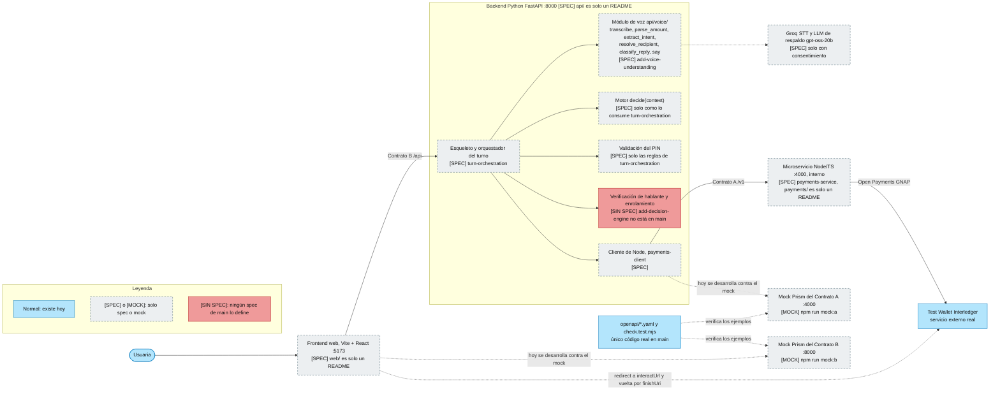
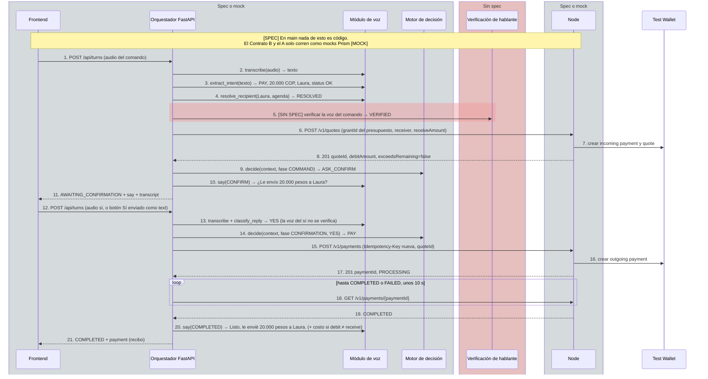
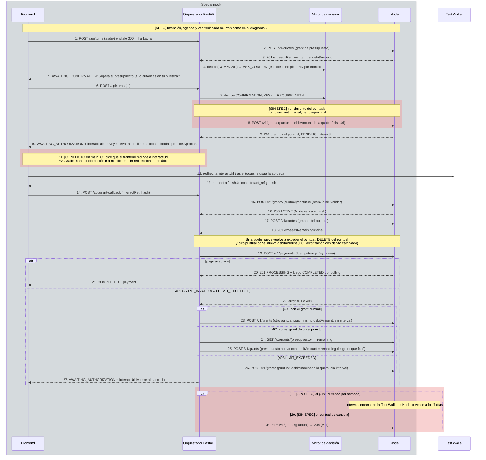
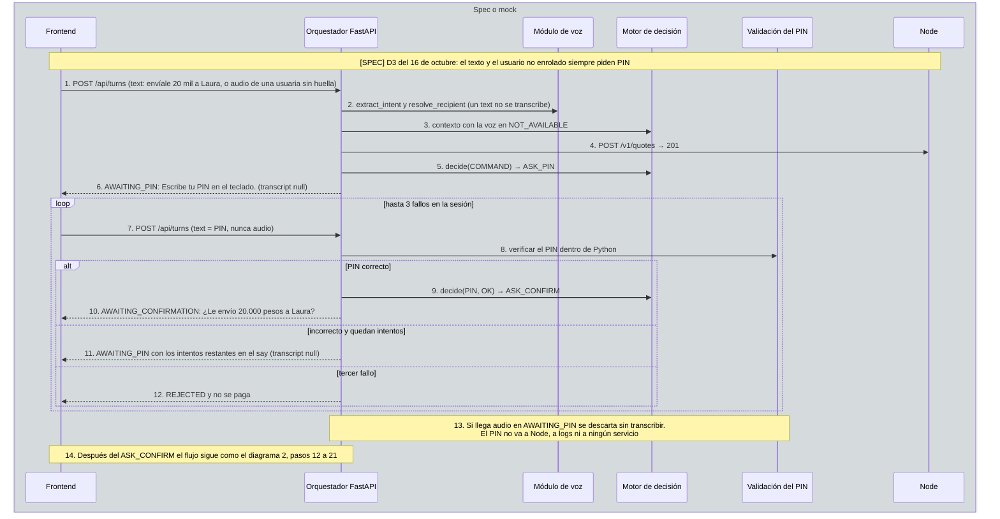
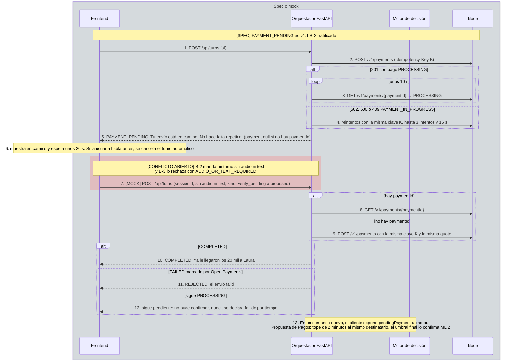
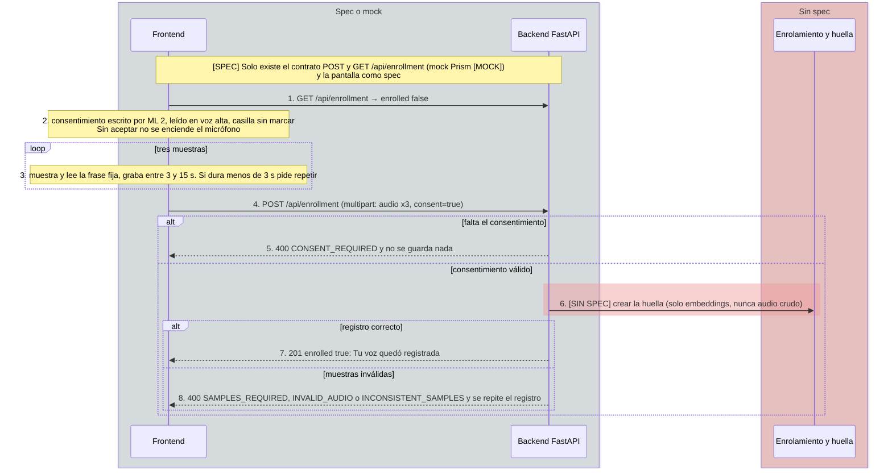
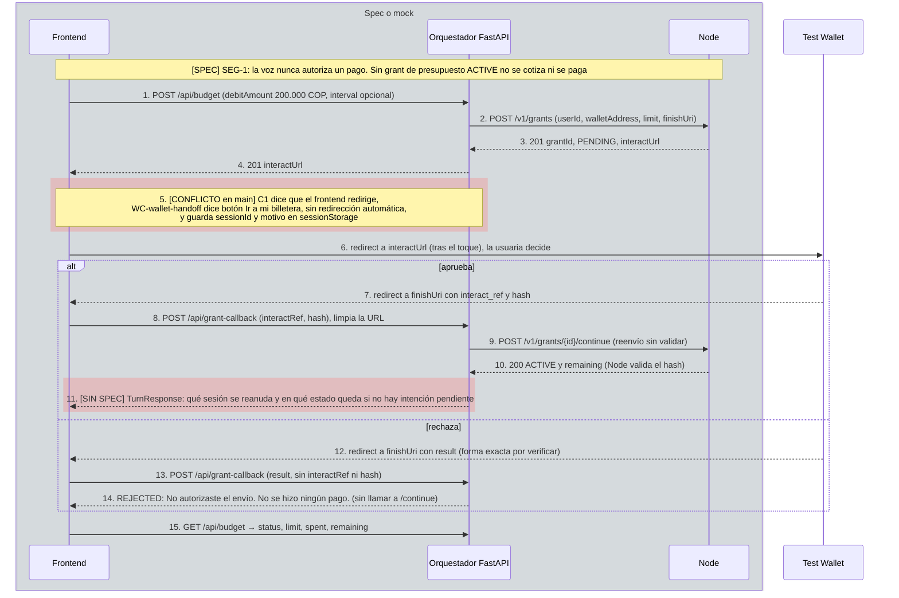

# Flujo actual de EZPAY (según `main`)

Cómo interactúan Frontend, backend Python, Node y la Test Wallet **según los specs, los contratos y
los mocks que hay hoy en `main`** (commit `7d7f1fe`, 16 de octubre de 2026). Es el comportamiento
**diseñado**: en `main` no hay código de backend ni de Node (`api/`, `payments/` y `web/` son solo
un `README.md`). Lo único real son los mocks Prism de `openapi/` y `openapi/check.test.mjs`.

Este archivo es el punto de partida (A). El mismo flujo con los PRs abiertos mergeados (B) está en
[`flujo-con-prs.md`](./flujo-con-prs.md), con los mismos 7 diagramas en el mismo orden.

> Estado de revisión: escrito con ayuda de IA, **pendiente de lectura de Alexander
> (@jhonosorno-cmd)**. Si un documento fuente y este archivo chocan, gana el documento fuente
> (y entre contratos, v1.1 gana sobre v1).

## Índice

1. [Vista general de componentes y contratos](#1-vista-general-de-componentes-y-contratos)
2. [Pago normal dentro del presupuesto, por voz](#2-pago-normal-dentro-del-presupuesto-por-voz)
3. [Exceso de límite con grant puntual](#3-exceso-de-límite-con-grant-puntual)
4. [Comando por texto o usuario no enrolado: PIN](#4-comando-por-texto-o-usuario-no-enrolado-pin)
5. [`PAYMENT_PENDING` y turno de verificación](#5-payment_pending-y-turno-de-verificación)
6. [Enrolamiento de voz con consentimiento](#6-enrolamiento-de-voz-con-consentimiento)
7. [Autorizar el presupuesto y vuelta de la wallet](#7-autorizar-el-presupuesto-y-vuelta-de-la-wallet)

## Leyenda de colores y estilos

Los colores no son la única señal: cada elemento lleva además una etiqueta de texto
(`[SPEC]`, `[MOCK]`, `[SIN SPEC]`).

**Diagrama 1 (flowchart):**

| Estilo | Relleno y borde | Etiqueta | Significado en este archivo |
|---|---|---|---|
| Normal | azul `#B3E5FC`, borde `#0277BD` | (ninguna) | Existe de verdad hoy: la Test Wallet y los archivos de `openapi/` |
| Solo spec o mock | gris `#ECEFF1`, borde `#546E7A` **punteado** | `[SPEC]` o `[MOCK]` | Solo existe como spec o como mock Prism |
| Sin spec o conflicto | rojo `#EF9A9A`, borde `#B71C1C` | `[SIN SPEC]` | Ningún spec de `main` lo define |

**Diagramas 2 a 7 (secuencias):** Mermaid no permite punteado en `rect`, así que el equivalente
a "solo spec o mock" es el `box` gris sobre los participantes.

| Marca | Significado en este archivo |
|---|---|
| `box` gris `rgba(144,164,174,0.25)` "Spec o mock" | Participantes que solo existen como spec o mock. El primer mensaje lleva `[SPEC]` o `[MOCK]` |
| `box` rojo "Sin spec" y `rect` rojo `rgba(239,154,154,0.45)` | `[SIN SPEC]` o conflicto abierto entre fuentes de `main` |
| Participante sin `box` (Test Wallet) | Servicio real, sin cambio |

Los colores naranja (comportamiento distinto) y verde (pasa a código) se usan solo en
[`flujo-con-prs.md`](./flujo-con-prs.md).

## Claves de las fuentes

Cada paso numerado cita su fuente con estas claves. Rutas completas desde la raíz del repo.

| Clave | Archivo |
|---|---|
| `C1` | `docs/contratos-http-v1.md` |
| `C1.1` | `docs/contratos-cambios-propuestos-v1.1.md` (gana si choca con `C1`) |
| `OA`, `OB` | `openapi/contract-a.yaml`, `openapi/contract-b.yaml` (mocks Prism) |
| `DEC` | `docs/decisiones.md` |
| `SG` | `docs/spec-general.md` |
| `CV` | `docs/voz/contrato-voz.md` |
| `PC` | `openspec/changes/add-payments-client/specs/payments-client/spec.md` |
| `TO` | `openspec/changes/add-payments-client/specs/turn-orchestration/spec.md` |
| `PS`, `PS-D13` | `openspec/changes/add-payments-service/specs/payments-service/spec.md`, `.../design.md` (D13) |
| `VU-<capability>` | `openspec/changes/add-voice-understanding/specs/<capability>/spec.md` |
| `WC-<capability>` | `openspec/changes/add-voice-web-client/specs/<capability>/spec.md` |
| `TB` | `openspec/changes/add-team-baseline/specs/payment-safety/spec.md` y hermanos |

---

## 1. Vista general de componentes y contratos

El navegador solo habla con Python por el Contrato B, y Python con Node por el Contrato A (interno);
Node es el único que habla con Open Payments, y el navegador solo toca la Test Wallet para
aprobar un grant. Hoy ninguno de los tres servicios existe como código: se desarrollan contra los
mocks Prism. El motor, la verificación de hablante, el enrolamiento y el PIN no tienen spec propio
(`add-decision-engine` está por crear).

Fuentes

| Elemento | Fuente |
|---|---|
| Flechas y puertos | `C1` (diagrama inicial y "Contrato A / B"); CONV-5 en `TB` service-conventions |
| Frontend solo habla con Python | `WC-web-conversation` «Solo el Contrato B» |
| Módulo de voz y sus funciones | `CV` §1 y §4; `VU-*` |
| Groq con consentimiento, LLM solo como respaldo | `CV` §4 (`transcribe`, `extract_intent`); `VU-speech-transcription` |
| Orquestador, motor y PIN | `TO` «Flujo del turno», «Motor como función pura», «PIN incorrecto» |
| Sin spec de motor, verificación, enrolamiento, PIN | `C1.1` «Inconsistencias» (último punto); `DEC` «Pendientes» |
| Cliente de Node | `PC` Purpose |
| Node | `PS`; `C1` «Estado del grant» |
| Mocks y prueba de mocks | `openapi/README.md`; `package.json`; `openapi/check.test.mjs` |
| Redirect de la wallet | `C1` diagrama inicial; `WC-wallet-handoff` |

---

## 2. Pago normal dentro del presupuesto, por voz

Camino feliz diseñado, con la voz del comando verificada. La quote se pide **antes** del motor, el
"sí" no se verifica por voz, y el pago usa una `Idempotency-Key` nueva por intención. El polling
de ~10 s lo hace Python, nunca el navegador. Dentro de `main` hay dos textos para la pregunta
(`CV` §7 dice "20.000 pesos"; el ejemplo de `OB` dice "20 mil"). Sin voz verificada el camino es
el del diagrama 4.

Fuentes por paso

| Paso | Fuente |
|---|---|
| 1, 11, 21 | `C1` «Contrato B» (`POST /turns`, `TurnResponse`); `OB` `/api/turns` |
| 2 | `CV` §4 `transcribe`; `VU-speech-transcription` |
| 3 | `CV` §4 `extract_intent`; `VU-intent-extraction` (reglas primero, LLM como respaldo) |
| 4 | `CV` §4 `resolve_recipient`; `VU-contact-resolution` |
| 5 | `TO` «Flujo del turno»; algoritmo y umbrales **[SIN SPEC]**: `C1.1` «Inconsistencias», `DEC` «Pendientes» |
| 6, 8 | `TO` «La quote se pide antes del motor»; `C1` «Contrato A» `POST /quotes` |
| 7 | `PS` «Creación de quote» |
| 9 | `TO` «Motor como función pura» y escenario «Todo en orden» |
| 10 | `CV` §7 `CONFIRM`; `PC` «Monto que se dice antes de la confirmación» (B-6 en `C1.1`) |
| 12 | `WC-web-conversation` «Botones Sí y No como texto» |
| 13 | `VU-reply-classification`; `TO` «Solo se verifica la voz del comando»; `DEC` decisión 3 (D4) |
| 14 | `TO` escenario «Sí dentro del presupuesto» |
| 15 | `PC` «Una clave de idempotencia por intención de pago»; `C1` `POST /payments` |
| 16, 17 | `PS` «Pago exitoso», «Estado del pago» |
| 18, 19 | `PC` «Polling del estado del pago» |
| 20 | `CV` §7 `COMPLETED`; `PC` «Monto que se dice en el recibo del pago» |

---

## 3. Exceso de límite con grant puntual

Es el momento clave de la demo: dos consentimientos (el "sí" hablado y la aprobación en la wallet).
El grant puntual convive con el de presupuesto, que sigue `ACTIVE`. Si el pago falla con `401` o
`403` se vuelve a autorizar, y qué grant se pide depende del error. El vencimiento del puntual es
**[SIN SPEC]**: la decisión del 16 de octubre (vence por semana) contradice a `PC` y `PS-D13`, y
falta decidir cómo se implementa y si `DELETE` (A-1) sigue haciendo falta.

Fuentes por paso

| Paso | Fuente |
|---|---|
| 1, 6 | `C1` «Exceso de límite»; `WC-web-conversation` |
| 2, 3 | `PS` «Señal preventiva de exceso»; `C1` `POST /quotes` |
| 4 | `TO` «Sí con exceso de límite»; el exceso no pide PIN por monto: `DEC` párrafo bajo la tabla (D2), `TB` SEG-5/SEG-6 |
| 5 | `CV` §7 `AUTH_OVERRUN`; `C1` diagrama «Exceso de límite» |
| 7 | `TO` «Sí con exceso de límite» |
| 8 | `PC` «Reautorización puntual por exceso de límite» (tope = `debitAmount`, sin `interval`); `PS-D13`; vencimiento semanal: `DEC` decisión 1 y «Pendientes», `C1.1` B-9 |
| 9, 10 | `C1` `POST /grants`; `CV` §7 `AUTH_REDIRECT` |
| 11 | `C1` tabla `state` (AWAITING_AUTHORIZATION «redirige») frente a `WC-wallet-handoff` «Explicar el paso antes de redirigir» |
| 12, 13 | `C1` diagrama «Exceso de límite»; `WC-wallet-handoff` |
| 14 | `C1.1` B-1; `PC` «Reenvío del callback sin validación» |
| 15, 16 | `C1` `POST /grants/{id}/continue` (hash); `PS` «Continuación del grant» |
| 17, 18 | `PC` «Recotización después del callback» y «Recotización con débito cambiado» |
| 19–21 | `PC` «Una clave de idempotencia por intención de pago», «Polling» |
| 22 | `C1` `POST /payments` (`401 GRANT_INVALID`, `403 LIMIT_EXCEEDED` disparan la reautorización) |
| 23 | `PC` «Grant puntual inválido» |
| 24, 25 | `PC` «Grant de presupuesto inválido» |
| 26 | `PC` escenario «Límite excedido al pagar» |
| 27 | `PC` (los tres requisitos anteriores: el turno pasa a `AWAITING_AUTHORIZATION`) |
| 28 | **[SIN SPEC]** `DEC` decisión 1 y «Pendientes» (¿`limits.interval` de una semana, no probado en la Test Wallet, o Node lo vence a los 7 días?) |
| 29 | `C1.1` A-1; `PC` «Cancelación del grant puntual»; `PS` «Cancelación de un grant»; `PS-D13` («no vence por semana») |

---

## 4. Comando por texto o usuario no enrolado: PIN

Un comando por texto, o por voz de una persona sin huella, no puede verificarse por voz y por eso
pasa por el PIN. El PIN se **suma** al "sí" hablado, no lo reemplaza. Hasta que exista el teclado
(H3) el PIN se escribe en el campo de texto. El conteo de intentos lo lleva el componente de PIN de
ML 2, que en `main` solo tiene reglas de comportamiento, sin spec propio.

Fuentes por paso

| Paso | Fuente |
|---|---|
| 1 | `WC-web-conversation` «Comando por texto como camino alterno»; `DEC` decisión 2 (D3) |
| 2 | `CV` §2 (un `text` no pasa por `transcribe`); `VU-intent-extraction` |
| 3 | `TO` «Comando por texto sin verificación de voz» y «Usuario no enrolado» |
| 4 | `TO` «La quote se pide antes del motor» |
| 5 | `TO` escenario «Texto pide PIN»; `TB` SEG-6 |
| 6 | `CV` §7 `PIN_KEYBOARD`; `C1.1` B-7 (`transcript` null) |
| 7 | `C1.1` B-8 y `DEC` decisión 2 (hasta H3 el PIN va en el campo de texto) |
| 8 | `TO` «El PIN nunca sale de Python»; reglas de conteo: `TO` «PIN incorrecto»; validador **[SIN SPEC]** en `main` |
| 9, 10 | `TO` (el PIN se suma al «sí»); `TB` SEG-2; `CV` §7 `CONFIRM` |
| 11 | `TO` «PIN incorrecto» (primer intento fallido: quedan 2); `C1.1` B-8 |
| 12 | `TO` «Intentos agotados»; `C1.1` B-8 |
| 13 | `TO` «Audio en AWAITING_PIN», «Logs del turno sin el cuerpo del request» |
| 14 | `TO` «Flujo del turno» |

---

## 5. `PAYMENT_PENDING` y turno de verificación

Si el polling de ~10 s o los 3 reintentos no resuelven el pago, el turno queda en `PAYMENT_PENDING`
(nunca en `REJECTED`) y el frontend manda **un solo** turno de verificación unos 20 s después.
Un pago solo es `FAILED` si Open Payments lo marca así. El turno automático es un conflicto abierto
de v1.1: `openapi/contract-b.yaml` ya lo mockea con `kind=verify_pending` (`x-proposed`), pero los
specs de `main` no lo definen.

Fuentes por paso

| Paso | Fuente |
|---|---|
| 1 | `C1` «Contrato B» |
| 2, 4 | `PC` «Reintento con la misma clave ante resultado incierto o pago en curso» |
| 3 | `PC` «Polling del estado del pago» |
| 5 | `PC` «Pago pendiente (PAYMENT_PENDING)»; `C1.1` B-2; `CV` §7 `PAYMENT_PENDING` |
| 6 | `WC-web-conversation` «Pago pendiente» (escenario «La usuaria habla antes») |
| 7 | `PC` «Verificación automática única»; `C1.1` «Inconsistencias» (B-2 y B-3); `OB` `/api/turns` (`x-proposed`, `kind=verify_pending`); `openapi/README.md`; `VU-speech-transcription` «Entrada de texto o de audio, no ambas ni ninguna» (excepción que Pagos no aprobó) |
| 8, 9 | `PC` «Verificación del pago pendiente en la próxima interacción» |
| 10–12 | `PC` mismos escenarios, «Sin fallos declarados por tiempo» |
| 13 | `TO` «Decisión sobre el pago pendiente»; `PC` «Pago pendiente disponible para el motor» |

---

## 6. Enrolamiento de voz con consentimiento

El Contrato B define las rutas y los errores (B-5) y la pantalla del frontend tiene spec, pero **todo
lo que hay detrás del `POST` en el backend es [SIN SPEC]**: `speaker-verification` y
`voice-enrollment` no existen en `main`. El texto de consentimiento y las tres frases los entrega
ML 2 y todavía faltan. Nunca se guarda audio crudo, solo embeddings.

Fuentes por paso

| Paso | Fuente |
|---|---|
| 1 | `C1.1` B-5 (`GET /enrollment`); `OB` `/api/enrollment` (`x-proposed`, forma `{ enrolled }`); `WC-enrollment-ui` «Saber si hay alguien registrado» |
| 2 | `WC-enrollment-ui` «Consentimiento antes de grabar (PRIV-2)»; `TB` voice-privacy PRIV-2; texto pendiente de ML 2: `WC` tasks.md 1.2 |
| 3 | `WC-enrollment-ui` «Tres muestras con frases fijas» |
| 4 | `C1` «Contrato B» (`POST /enrollment`) |
| 5 | `C1` («400 CONSENT_REQUIRED»); `TB` PRIV-2 |
| 6 | **[SIN SPEC]**: `C1.1` «Inconsistencias» (último punto); `DEC` «Pendientes» (`voice-enrollment`, `speaker-verification`); `TB` PRIV-1 (solo embeddings) |
| 7 | `WC-enrollment-ui` «Resultado del registro» |
| 8 | `C1.1` B-5; `WC-enrollment-ui` escenarios de error |

---

## 7. Autorizar el presupuesto y vuelta de la wallet

Dos caminos llevan acá: el botón "Autorizar presupuesto" y un comando de pago sin presupuesto
(Python responde `AWAITING_AUTHORIZATION` con la `interactUrl` del presupuesto, sin cotizar). Si la
wallet rechaza, Python **no** llama a `/continue` y descarta la intención. Hay dos huecos en
`main`: el redirect del rechazo está en `[VERIFICAR]` (E3) y el `/grant-callback` no trae
`sessionId` ni dice qué sesión reanuda, ni qué estado sigue a una aprobación sin intención pendiente.

Fuentes por paso

| Paso | Fuente |
|---|---|
| 1 | `C1` «Contrato B» (`POST /budget`); `WC-wallet-handoff` «Autorizar el presupuesto» (monto e `interval` pendientes de decisión del equipo) |
| 2, 3 | `C1` `POST /grants`; `PC` «Sin grant de presupuesto activo (SEG-1)» |
| 4 | `OB` `/api/budget` |
| 5 | `C1` tabla `state` frente a `WC-wallet-handoff` «Explicar el paso antes de redirigir» y «La sesión sobrevive a la wallet» |
| 6, 7 | `C1` diagrama «Exceso de límite»; `WC-wallet-handoff` |
| 8 | `C1.1` B-1; `WC-wallet-handoff` «Reenvío completo del callback» y «El callback se usa una sola vez» |
| 9, 10 | `PC` «Reenvío del callback sin validación»; `C1` (hash); `PS` «Continuación del grant» |
| 11 | **[SIN SPEC]**: `OB` `/api/grant-callback` («The resumed turn») no define `sessionId` ni el estado; `CV` §7 `AUTH_APPROVED` es solo el texto |
| 12 | `C1` «Pendientes» (`[VERIFICAR]` E3); `C1.1` B-1; `PS` «Rechazo en la wallet» |
| 13, 14 | `PC` «Callback robusto ante rechazo»; `WC-wallet-handoff` escenario «Rechazo» |
| 15 | `C1` «Contrato B» (`GET /budget`) |

