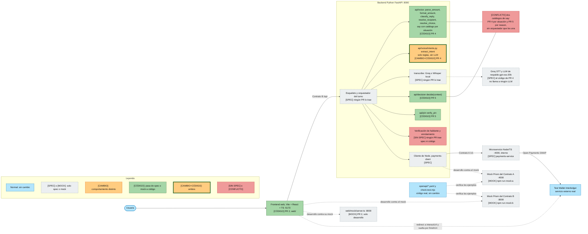
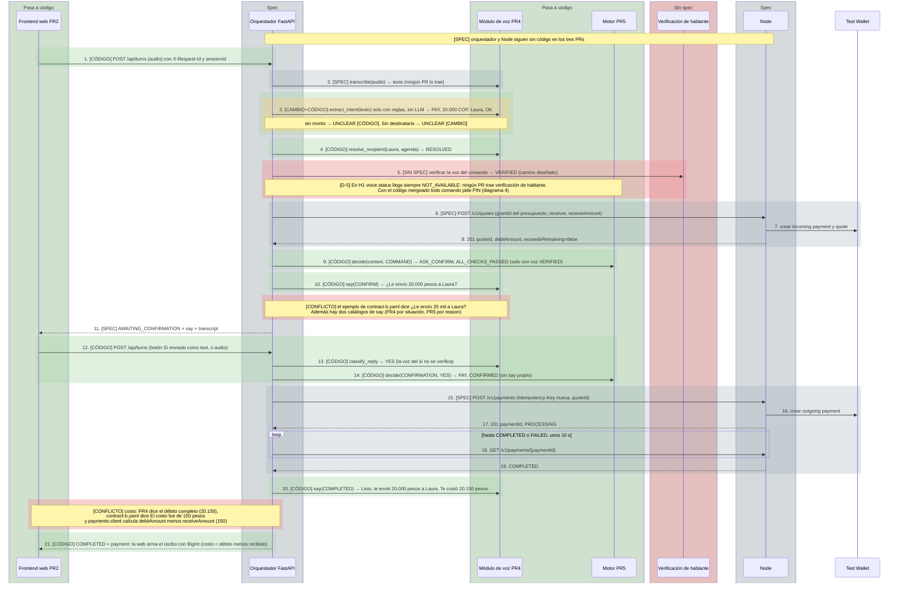
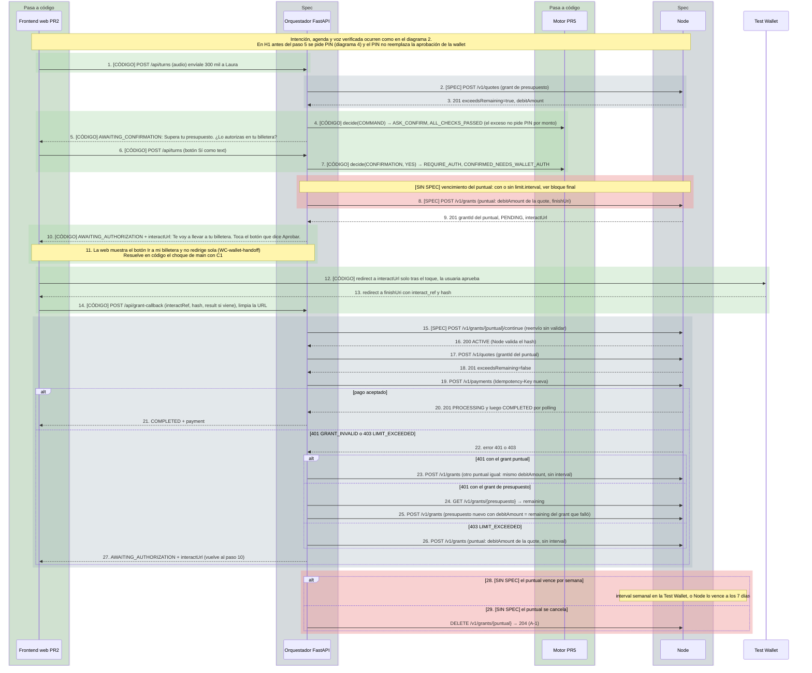
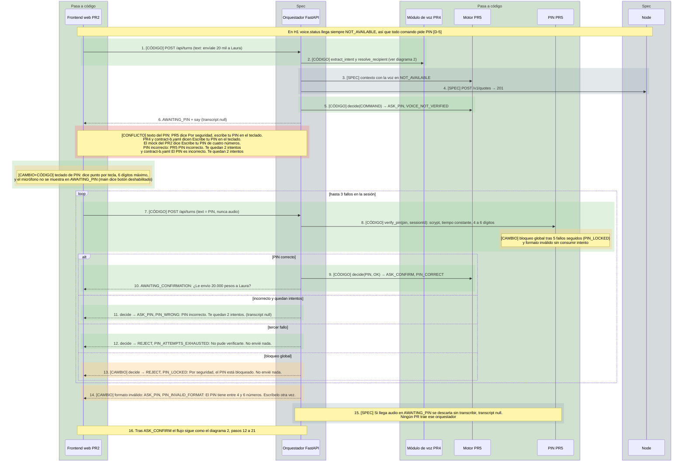
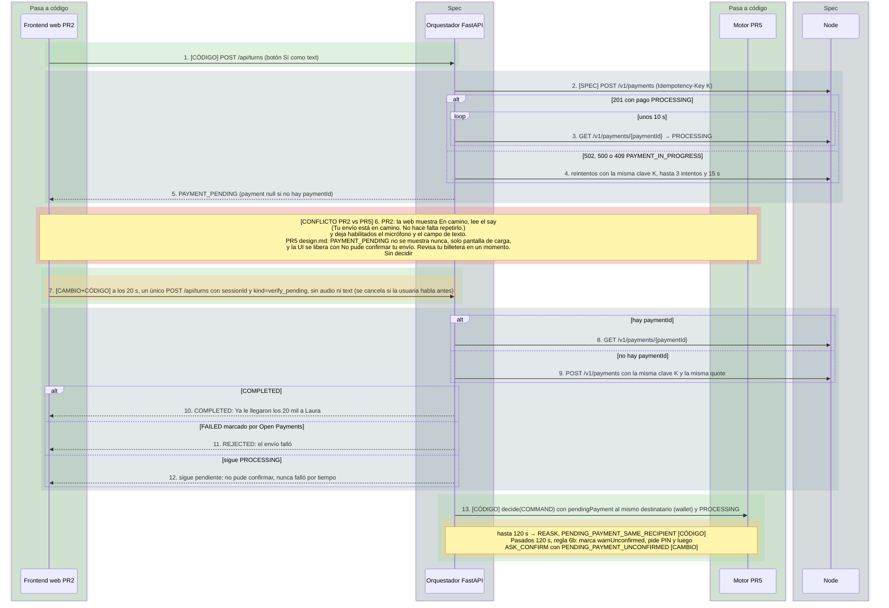
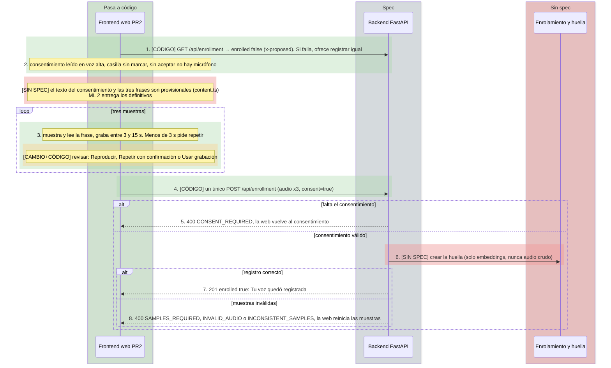
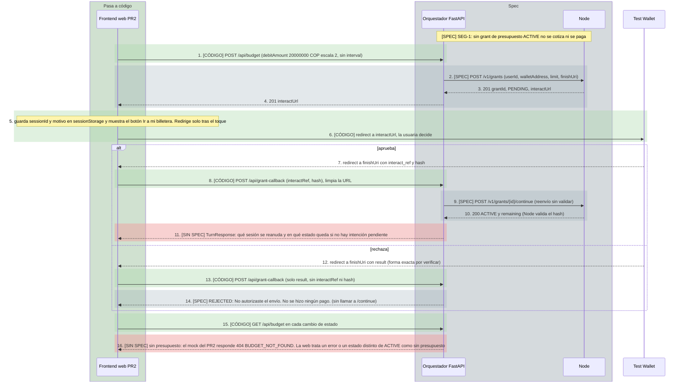

# Flujo de EZPAY con los PRs abiertos mergeados (B)

El mismo flujo de [`flujo-actual.md`](./flujo-actual.md) (A, según `main`), suponiendo que se
mergean los tres PRs abiertos al 16 de octubre de 2026 (confirmados con `gh pr list --state open`):

| PR | Rama | Autor | Qué trae | Commit leído |
|---|---|---|---|---|
| #2 | `feat/web-skeleton` | rualesjuan-ui | `web/` real (Vite + React + TypeScript) con su mock del Contrato B | `686dd0a` |
| #4 | `voz/h1-parser` | Sebasruiz00 | `api/voice/` (montos, respuestas, `say`, agenda, intención sin LLM) | `ab15512` |
| #5 | `ml2/verificacion-calidad` | Valdex328 | `api/decision/` (motor), `api/pin/` y el spec `add-decision-engine` | `5df6a7f` |

Los PRs se leyeron solo con `gh pr view`, `gh pr diff` y `git show origin/<rama>:<ruta>`, sin
mergear ni cambiar de rama. Si un PR recibe commits nuevos, este archivo queda desactualizado
respecto de ellos. Las referencias `L<n>` son líneas de esos commits.

> Estado de revisión: escrito con ayuda de IA, **pendiente de lectura de Alexander
> (@jhonosorno-cmd)**. Donde las fuentes chocan, el diagrama lo marca en rojo y **no decide**.

Ningún PR trae el orquestador FastAPI, el cliente de Node, el microservicio Node ni la verificación
de hablante o el enrolamiento del backend: siguen como `[SPEC]` o `[SIN SPEC]`. Y como el
orquestador no existe, tampoco existe el código que une el catálogo `say` de #4 con las plantillas
por `reason` de #5.

## Índice

1. [Vista general de componentes y contratos](#1-vista-general-de-componentes-y-contratos)
2. [Pago normal dentro del presupuesto, por voz](#2-pago-normal-dentro-del-presupuesto-por-voz)
3. [Exceso de límite con grant puntual](#3-exceso-de-límite-con-grant-puntual)
4. [Comando por texto o usuario no enrolado: PIN](#4-comando-por-texto-o-usuario-no-enrolado-pin)
5. [`PAYMENT_PENDING` y turno de verificación](#5-payment_pending-y-turno-de-verificación)
6. [Enrolamiento de voz con consentimiento](#6-enrolamiento-de-voz-con-consentimiento)
7. [Autorizar el presupuesto y vuelta de la wallet](#7-autorizar-el-presupuesto-y-vuelta-de-la-wallet)
8. [Conflictos que quedan abiertos](#8-conflictos-que-quedan-abiertos)

## Leyenda de colores y estilos

Los colores no son la única señal: cada elemento lleva también una etiqueta de texto. Todo lo que
**cambia respecto de A** va en un estilo distinto del normal.

**Diagrama 1 (flowchart):**

| Estilo | Relleno y borde | Etiqueta | Significado |
|---|---|---|---|
| Normal, sin cambio | azul `#B3E5FC`, borde `#0277BD` | (ninguna) | Existe hoy y no cambia |
| Solo spec o mock | gris `#ECEFF1`, borde `#546E7A` **punteado** | `[SPEC]` o `[MOCK]` | Sigue siendo solo spec o mock |
| (1) Comportamiento distinto | naranja `#FFCC80`, borde `#E65100` | `[CAMBIO]` | Se comporta distinto de lo que dice `main` |
| (2) Pasa de spec o mock a código | verde `#A5D6A7`, borde `#1B5E20` | `[CÓDIGO]` | Era spec o mock en A y ahora es código real |
| Ambos | naranja `#FFCC80`, borde verde `#1B5E20` grueso | `[CAMBIO+CÓDIGO]` | Pasa a código **y** además se comporta distinto |
| Conflicto abierto o `[SIN SPEC]` | rojo `#EF9A9A`, borde `#B71C1C` | `[SIN SPEC]` o `[CONFLICTO]` | Ningún spec lo define, o las fuentes chocan |

**Diagramas 2 a 7 (secuencias):** Mermaid no permite punteado en `rect`; "solo spec o mock" se
dibuja con el `rect` o `box` gris.

| Marca en la secuencia | Significado | Etiqueta en el mensaje |
|---|---|---|
| `rect` naranja `rgba(255,204,128,0.35)` | (1) Comportamiento distinto | `[CAMBIO]` |
| `rect` verde `rgba(165,214,167,0.35)` | (2) Pasa a código | `[CÓDIGO]` |
| `rect` verde exterior con `rect` naranja dentro | Ambos | `[CAMBIO+CÓDIGO]` |
| `rect` o `box` gris `rgba(144,164,174,0.25)` | Solo spec o mock (sin cambio) | `[SPEC]` o `[MOCK]` |
| `rect` o `box` rojo `rgba(239,154,154,0.45)` | Conflicto abierto o `[SIN SPEC]` | `[CONFLICTO]` o `[SIN SPEC]` |
| Participante sin `box` (Test Wallet) | Real, sin cambio | (ninguna) |

Un `box` verde sobre un participante significa que el componente pasa a código en alguno de los PRs;
qué mensajes concretos cambian lo dicen los `rect` de cada paso.

## Claves de las fuentes

Cada paso numerado cita su fuente con estas claves. Rutas desde la raíz del repo.

| Clave | Archivo |
|---|---|
| `C1`, `C1.1` | `docs/contratos-http-v1.md`, `docs/contratos-cambios-propuestos-v1.1.md` (gana `C1.1`) |
| `OA`, `OB` | `openapi/contract-a.yaml`, `openapi/contract-b.yaml` |
| `DEC`, `SG`, `CV` | `docs/decisiones.md`, `docs/spec-general.md`, `docs/voz/contrato-voz.md` |
| `PC`, `TO` | `openspec/changes/add-payments-client/specs/payments-client/spec.md`, `.../turn-orchestration/spec.md` |
| `PS`, `PS-D13` | `openspec/changes/add-payments-service/specs/payments-service/spec.md`, `.../design.md` |
| `VU-<cap>`, `WC-<cap>`, `TB` | specs de `add-voice-understanding`, `add-voice-web-client` y `add-team-baseline` |
| `#2:<ruta>` | `web/src/<ruta>` en `origin/feat/web-skeleton` (`686dd0a`) |
| `#4:<archivo>` | `api/voice/<archivo>` en `origin/voz/h1-parser` (`ab15512`) |
| `#5:<ruta>` | `api/<ruta>` u `openspec/changes/add-decision-engine/<ruta>` en `origin/ml2/verificacion-calidad` (`5df6a7f`) |

---

## 1. Vista general de componentes y contratos

Pasan a código el Frontend (#2), el módulo de voz salvo `transcribe` (#4) y el motor y el PIN (#5).
El orquestador, el cliente de Node y Node siguen como spec, y la verificación de hablante y el
enrolamiento del backend siguen sin spec. La extracción de intención es `[CAMBIO+CÓDIGO]`: además
de pasar a código, usa solo reglas (sin LLM), cuando `main` dice reglas primero y LLM de respaldo.
Las diferencias de comportamiento del motor y del PIN respecto de `main` se marcan en los
diagramas 4 y 5; en este no hay nodos solo `[CAMBIO]`.

Fuentes

| Elemento | Fuente |
|---|---|
| Frontend real y su mock | `#2:` árbol `web/` (`src/`, `mock/server.ts`); descripción del PR #2 |
| Voz sin `transcribe` | `#4:` `amounts.py`, `replies.py`, `phrases.py`, `contacts.py`, `intents.py`; ningún archivo transcribe |
| Intención solo con reglas | `#4:intents.py` L1-3 (docstring: «sin LLM; decisión de Sebastián, 2026-10-16»); `main` dice reglas primero y LLM de respaldo: `CV` §4 `extract_intent`, `VU-intent-extraction` «Las frases comunes se resuelven sin LLM» |
| Motor y PIN | `#5:decision/engine.py`, `#5:pin/pin.py`; spec `#5:openspec/changes/add-decision-engine/` (el proposal dice «Sin código», L23, pero el PR trae `api/decision/` y `api/pin/` con pruebas: se toma el código) |
| Dos catálogos de `say` | `#4:phrases.py` L38-60 (21 situaciones) frente a `#5:decision/templates.py` L12-60 (28 `reason`); 13 `reason` no tienen situación en `phrases.py` (`VOICE_NOT_VERIFIED`, `NEW_RECIPIENT`, `HIGH_AMOUNT`, los cuatro `PIN_*` de fallo y bloqueo, ambos `PENDING_PAYMENT_*`, `INTENT_AMBIGUOUS`, ambos `*_LOW_CONFIDENCE`, `REPLY_UNCLEAR_REJECTED`); el cuerpo del PR #4 pide acordar quién es dueño de las frases |
| Sin orquestador, cliente de Node, Node, verificación | `TO`, `PC`, `PS` siguen sin código; `C1.1` «Inconsistencias» y `DEC` «Pendientes»: el PR #5 solo agrega `decision-engine` y `pin-validation`, y deja `speaker-verification` y `voice-enrollment` para H2 |
| Contratos y puertos | `C1`; `openapi/README.md` |

---

## 2. Pago normal dentro del presupuesto, por voz

Es el camino diseñado (voz `VERIFIED`), dibujado como en A. Con el código mergeado, la intención sale
solo de reglas, el destinatario, el "sí" y los textos salen de `api/voice/`, y el motor decide con
su tabla. Pero en H1 la voz nunca llega verificada (D-5), así que en la práctica este camino se
corta en el diagrama 4. Los textos de la pregunta y del costo chocan con `contract-b.yaml` y con
`payments-client`.

Fuentes por paso

| Paso | Fuente |
|---|---|
| 1, 12 | `#2:api/client.ts` L39 (`X-Request-Id`) y L61-67 (`postTurn`, multipart); `#2:useConversation.ts` L80-84; `#2:screens/Conversation.tsx` L80-85 (Sí/No como `text`) |
| 2 | `CV` §4 `transcribe`; no hay archivo equivalente en `#4` |
| 3 | `#4:intents.py` L1-3, L179-210; sin monto: L161-163 (`UNCLEAR`), ya en `VU-intent-extraction` «Transcripción sin monto»; sin destinatario: L137-139 (`UNCLEAR`), sin escenario en `main`; `main` pide reglas primero y LLM de respaldo (`CV` §4) |
| 4 | `#4:contacts.py` L127 `resolve_recipient` |
| 5 | **[SIN SPEC]** `C1.1` «Inconsistencias»; `#5:openspec/.../design.md` («en H1, `voice.status` llega siempre `NOT_AVAILABLE`»); `#5:decision/engine.py` L113-114 |
| 6–8 | `TO` «La quote se pide antes del motor»; `PS` «Creación de quote» |
| 9 | `#5:decision/engine.py` L116-124 (regla 9), `models.py` `Reason.ALL_CHECKS_PASSED` |
| 10 | `#4:phrases.py` L49 y L122-133; `#5:decision/templates.py` L40-43; `OB` ejemplo `awaiting-confirmation` L458; el cuerpo del PR #4 declara el choque |
| 11, 21 | `C1` `TurnResponse`; recibo: `#2:components/Receipt.tsx` L6 y `lib/money.ts` L14-16 (`BigInt`) |
| 13 | `#4:replies.py` L38 `classify_reply` |
| 14 | `#5:decision/engine.py` L142-149; `templates.py` L62-65 (`CONFIRMED` sin `say`) |
| 15–19 | `PC` «Una clave de idempotencia por intención de pago», «Polling del estado del pago» |
| 20 | `#4:phrases.py` L63 (`COST_SUFFIX`) y L130-132 (costo = débito completo); `OB` ejemplo `completed` L514; `PC` «Monto que se dice en el recibo del pago» |

---

## 3. Exceso de límite con grant puntual

Cambia poco respecto de A: la decisión del exceso y el pedido a la wallet pasan a código (motor #5
y web #2), y el motor deja una razón explícita (`CONFIRMED_NEEDS_WALLET_AUTH`) con el texto ya
previsto en `CV` §7. El grant puntual, el `alt` de `401` y `403` y su vencimiento siguen como spec;
el vencimiento sigue **[SIN SPEC]** (D-6). En `contract-b.yaml` el ejemplo de este `say` es otro
("Te llevo a tu billetera para que apruebes el envío.").

Fuentes por paso

| Paso | Fuente |
|---|---|
| 1, 6 | `#2:api/client.ts` L61-67; `#2:screens/Conversation.tsx` L80-85 |
| 2, 3 | `PS` «Señal preventiva de exceso»; `C1` `POST /quotes` |
| 4, 5 | `#5:decision/engine.py` L116-124; `templates.py` L40-43 (`EXCEEDS`); `#4:phrases.py` L55 (`AUTH_OVERRUN`); el exceso no pide PIN por monto: `DEC` párrafo bajo la tabla (D2) y `#5:openspec/.../design.md` (regla 9) |
| 7 | `#5:decision/engine.py` L145-148 |
| 8 | `PC` «Reautorización puntual por exceso de límite»; `PS-D13`; vencimiento semanal: `DEC` decisión 1 y «Pendientes», `C1.1` B-9 |
| 9 | `C1` `POST /grants` |
| 10 | `#5:decision/templates.py` L56 y `#4:phrases.py` L56 (mismo texto); `CV` §7 `AUTH_REDIRECT` ya lo tenía; `OB` ejemplo `awaiting-authorization` L505 dice otra frase |
| 11 | `#2:screens/Conversation.tsx` L42-45 y L73-78 (`window.location.assign` solo en el `onClick`); `WC-wallet-handoff` «Explicar el paso antes de redirigir»; `C1` tabla `state` dice «redirige» (choque dentro de `main`) |
| 12–14 | `#2:screens/GrantCallback.tsx` L5-15; `#2:lib/callback.ts` L4-11 (reenvía `interact_ref`, `hash`, `result`); `C1.1` B-1 |
| 15–27 | `PC` «Reintento…», «Recotización después del callback», «Recotización con débito cambiado», «Grant puntual inválido», «Grant de presupuesto inválido» y escenario «Límite excedido al pagar»; `C1` `POST /payments` |
| 28 | **[SIN SPEC]** `DEC` decisión 1 y «Pendientes» |
| 29 | `C1.1` A-1; `PC` «Cancelación del grant puntual»; `PS-D13` |

---

## 4. Comando por texto o usuario no enrolado: PIN

El PIN pasa a código (`verify_pin`, 3 fallos por sesión, formato de 4 a 6 dígitos) y el teclado de
la web también. Es **comportamiento distinto** de `main` el bloqueo global de 5 fallos, que un
formato inválido no consuma intento y que el micrófono se oculte en vez de deshabilitarse. Los tres
PRs usan textos distintos para pedir el PIN: queda marcado como conflicto.

Fuentes por paso

| Paso | Fuente |
|---|---|
| 1, 7 | `#2:screens/Conversation.tsx` L91 (`PinPad` envía `sendText`) y L110 (`TextCommand`); `#2:components/PinPad.tsx` L5-16 |
| 2 | `#4:intents.py`, `#4:contacts.py` (ver diagrama 2) |
| 3, 4 | `TO` «Comando por texto sin verificación de voz», «La quote se pide antes del motor» |
| 5 | `#5:decision/engine.py` L113-114; `templates.py` L37 |
| 6 | texto: `#5:decision/templates.py` L37; `#4:phrases.py` L53 (`PIN_KEYBOARD`); `OB` L476; `#2:mock/server.ts` L79; `C1.1` B-7 (`transcript` null) |
| Nota del teclado | `#2:components/PinPad.tsx` L4-16; `#2:screens/Conversation.tsx` L18 y L125-131 (el dock del micrófono no se muestra); la nota «Esperaba un botón deshabilitado, pasó que el dock tapaba el teclado, cambio» está en el diff del PR #2 sobre `WC-web-conversation` «Sin micrófono en el PIN» |
| 8 | `#5:pin/pin.py` L30-40 (3 y 5 fallos, 4 a 6 dígitos, scrypt), L89-96, L115-154; bloqueo global L151-153 y formato inválido sin consumir intento L116-119: **no están en `main`** (`TO` «PIN incorrecto» solo habla de 3 intentos por sesión) |
| 9, 10 | `#5:decision/engine.py` L131-134; `templates.py` L44-47 |
| 11 | `#5:decision/engine.py` L135-137; `templates.py` L48-51; `#2:mock/server.ts` L133-134; `OB` L485 |
| 12 | `#5:decision/engine.py` L137-138; `templates.py` L52; `TO` «Intentos agotados» |
| 13 | `#5:decision/engine.py` L129-130; `templates.py` L53 |
| 14 | `#5:decision/engine.py` L139; `templates.py` L54 |
| 15 | `TO` «Audio en AWAITING_PIN», «Respuesta de un turno de PIN» |
| 16 | `TO` «Flujo del turno» |

---

## 5. `PAYMENT_PENDING` y turno de verificación

El turno automático lleva `kind=verify_pending`: ya estaba como `x-proposed` en el mock de `main`, y
ahora pasa a código en la web. Es `[CAMBIO+CÓDIGO]` porque los specs ratificados no definen ese
campo. Las reglas 6 y 6b del motor pasan a código; la 6b (aviso de pago sin confirmar tras la
ventana) es nueva respecto de `main`. El choque PR #2 contra PR #5 sobre mostrar `PAYMENT_PENDING`
queda **abierto**: este archivo no lo decide.

Fuentes por paso

| Paso | Fuente |
|---|---|
| 1 | `#2:screens/Conversation.tsx` L80-85 |
| 2–5 | `PC` «Reintento con la misma clave…», «Polling del estado del pago», «Pago pendiente (PAYMENT_PENDING)»; `#4:phrases.py` L59 (texto del `say`) |
| 6 | PR #2: `#2:screens/Conversation.tsx` L18 (`CAN_SPEAK` incluye `PAYMENT_PENDING`), L93-102 (sección «En camino») y L110 (`TextCommand`); `#2:useConversation.ts` L45 (`speak`). PR #5: `#5:openspec/.../design.md` (notas de la regla 6: «no se muestran nunca a la usuaria», pantalla de carga) y `#5:openspec/.../specs/decision-engine/spec.md` (plantilla del orquestador «No pude confirmar tu envío. Revisa tu billetera en un momento.») |
| 7 | `#2:api/client.ts` L69-75 (`postVerifyPending`); `#2:useConversation.ts` L86-99 (un solo turno, sin polling) y L65-78 (la usuaria habla antes: se cancela); `#2:config.ts` L9 (20 s); `OB` `/api/turns` (`x-proposed` ya en `main`); `C1.1` B-2 y «Inconsistencias» (B-2 contra B-3) |
| 8–12 | `PC` «Verificación del pago pendiente en la próxima interacción», «Sin fallos declarados por tiempo» |
| 13 | `#5:decision/engine.py` L30-45 (`_pending_flags`: wallet, `PROCESSING`, 120 s) y L109-111 (regla 6), L123-124 y L132-134 (regla 6b); `templates.py` L32-36; `TO` «Decisión sobre el pago pendiente» (en `main` el tope era una propuesta de 2 minutos) |

---

## 6. Enrolamiento de voz con consentimiento

La pantalla de enrolamiento pasa a código en la web (consentimiento, tres muestras, errores de B-5
y `GET /enrollment` con forma `x-proposed`). Revisar, repetir con confirmación y usar cada muestra
es comportamiento nuevo: lo agrega el PR #2 a `enrollment-ui` y no está en `main`. Todo lo que hay
detrás del `POST` en el backend sigue **[SIN SPEC]** (el PR #5 deja `speaker-verification` y
`voice-enrollment` para H2).

Fuentes por paso

| Paso | Fuente |
|---|---|
| 1 | `#2:screens/Conversation.tsx` L26-31; `#2:api/client.ts` L92; `OB` `/api/enrollment` (`x-proposed`) |
| 2 | `#2:enrollment/Enrollment.tsx` L13 y L22; `WC-enrollment-ui` «Consentimiento antes de grabar (PRIV-2)» |
| Nota de textos | `#2:enrollment/content.ts` L1-2 («[PENDIENTE ML 2]»); `WC` tasks.md 1.2 |
| 3 | `#2:enrollment/enrollmentFlow.ts` L3-4 (`MIN_SAMPLE_MS` = 3 s), L46-49 (muy corto), L50-61 (revisar, repetir, usar); el requisito «Grabar, revisar y confirmar cada muestra» lo agrega el diff del PR #2 a `WC-enrollment-ui` |
| 4 | `#2:api/client.ts` L85-90 (`consent=true`); `C1` «Contrato B» |
| 5 | `#2:enrollment/enrollmentFlow.ts` L65 |
| 6 | **[SIN SPEC]** `C1.1` «Inconsistencias»; `DEC` «Pendientes»; descripción del PR #5 («Siguiente (H2): `speaker-verification` y `voice-enrollment`») |
| 7, 8 | `C1.1` B-5; `#2:enrollment/enrollmentFlow.ts` L62-67; `#2:api/client.ts` L14-25 |

---

## 7. Autorizar el presupuesto y vuelta de la wallet

Todo el lado web pasa a código: el botón "Autorizar presupuesto" con monto fijo de 200.000 COP, la
pantalla intermedia sin redirección automática, y `/grant-callback`, que reenvía `interact_ref`,
`hash` y `result` y limpia la URL. El rechazo en la wallet termina en `REJECTED`, según el spec. Dos
cosas siguen **[SIN SPEC]**: qué responde `GET /budget` si no hay presupuesto, y qué sesión y
estado reanuda el callback cuando la aprobación no viene de una intención pendiente.

Fuentes por paso

| Paso | Fuente |
|---|---|
| 1 | `#2:screens/Conversation.tsx` L47-56 (`askBudget`); `#2:config.ts` L4-8 (`DEMO_BUDGET` = 20000000 COP, escala 2); `#2:api/client.ts` L79-80 (`postBudget` solo con `debitAmount` si no hay `interval`); `WC-wallet-handoff` «Autorizar el presupuesto» |
| 2–4 | `C1` `POST /grants`; `PC` «Sin grant de presupuesto activo (SEG-1)»; `OB` `/api/budget` |
| 5, 6 | `#2:screens/Conversation.tsx` L42-45 (`saveHandoffReason`, `window.location.assign` solo tras el toque) y L73-78; `#2:lib/session.ts` L5-18; `WC-wallet-handoff` «La sesión sobrevive a la wallet» |
| 7, 8 | `#2:screens/GrantCallback.tsx` L5-15 (una sola vez, `history.replaceState`); `#2:lib/callback.ts` L4-11; `C1.1` B-1 |
| 9, 10 | `PC` «Reenvío del callback sin validación»; `PS` «Continuación del grant» |
| 11 | **[SIN SPEC]** `OB` `/api/grant-callback` («The resumed turn») no define `sessionId` ni estado; el mock del PR #2 usa `lastSession` (`mock/server.ts` L39) |
| 12–14 | `C1` «Pendientes» (`[VERIFICAR]` E3); `PC` «Callback robusto ante rechazo»; `#2:lib/callback.ts` (envía solo `result`) |
| 15 | `#2:screens/Conversation.tsx` L33-36 y L58-59 (`hasBudget` = `status === "ACTIVE"`) |
| 16 | **[SIN SPEC]** `#2:mock/server.ts` L189-193: `404 BUDGET_NOT_FOUND` con la nota «[PREGUNTA ABIERTA a Pagos]». El cuerpo del PR #2 describe otra cosa (`{status: "NONE"}`): el código de la rama manda. Ningún spec de `main` define esa respuesta (`C1`, `OB` `/api/budget` solo define el caso con presupuesto) |

---

## 8. Conflictos que quedan abiertos

Este archivo los marca y **no los decide**; cada uno necesita una decisión del equipo.

| # | Conflicto | Fuentes | Diagrama |
|---|---|---|---|
| 1 | `PAYMENT_PENDING`: PR #2 lo muestra ("en camino", lee el `say`, deja micrófono y texto habilitados) y PR #5 dice que nunca se muestra (solo pantalla de carga; la UI se libera con «No pude confirmar tu envío…») | `#2:Conversation.tsx` L93-110; `#5:openspec/.../design.md` regla 6 | 5 |
| 2 | Textos de PIN: PR #5 «Por seguridad, escribe tu PIN en el teclado.», PR #4 y `contract-b.yaml` «Escribe tu PIN en el teclado.», mock del PR #2 «Escribe tu PIN de cuatro números.». Y de PIN incorrecto: «PIN incorrecto. Te quedan 2 intentos.» (#5, #2) contra «El PIN es incorrecto. Te quedan 2 intentos.» (`OB`) | `#5:templates.py` L37 y L48-51; `#4:phrases.py` L53; `OB` L476 y L485; `#2:mock/server.ts` L79 y L134 | 4 |
| 3 | Textos de `say` y costo: «¿Le envío 20.000 pesos a Laura?» (#4) contra «¿Le envío 20 mil a Laura?» (`OB`); «Te costó 20.150 pesos» (#4, débito completo) contra «El costo fue de 150 pesos» (`OB`) y `payments-client` (débito menos recibido); y dos catálogos de `say` (#4 por situación, #5 por `reason`, 13 `reason` sin situación) sin orquestador que los una | `#4:phrases.py` L49, L63, L130-132; `OB` L458 y L514; `PC` «Monto que se dice en el recibo del pago»; `#5:templates.py` L12-60 | 2, 4 |
| 4 | Intención solo con reglas, sin LLM (#4) contra `main`, que dice reglas primero y LLM de respaldo (`openai/gpt-oss-20b`) | `#4:intents.py` L1-3; `CV` §4; `VU-intent-extraction` | 2 |
| 5 | `kind=verify_pending` está en el mock y el PR #2 lo manda, pero v1.1 B-2 y B-3 dejan el turno automático sin definir (abierto, `C1.1` «Inconsistencias») | `OB` `/api/turns`; `#2:client.ts` L69-75 | 5 |
| 6 | En H1 `voice.status` llega siempre `NOT_AVAILABLE`: todo comando pide PIN, aunque los diagramas 2 y 3 dibujan el camino diseñado | `#5:openspec/.../design.md`; `#5:engine.py` L113-114 | 2, 3, 4 |
| 7 | `GET /api/budget` sin presupuesto, y qué sesión y estado reanuda `/grant-callback`: ningún spec ni PR lo define | `#2:mock/server.ts` L189-193; `OB` | 7 |

## Notas de verificación

Estas lecturas corrigen hallazgos previos y se verificaron contra las fuentes:

- `GET /api/budget` sin presupuesto: el **código** del PR #2 responde `404 BUDGET_NOT_FOUND`
  (`mock/server.ts` L189-193); el cuerpo del PR dice `{status: "NONE"}`. Se tomó el código.
- El cuerpo del PR #2 dice que el enrolamiento no está; el diff trae `web/src/enrollment/`. Se tomó el diff.
- El proposal del PR #5 dice «Sin código»; el PR trae `api/decision/` y `api/pin/` con pruebas. Se tomó el código.
- `kind=verify_pending` ya está en `main` como `x-proposed` en `openapi/contract-b.yaml`, no solo en el PR #2.
- Los PRs #2 y #5 usan «Sí/No», `alias` y `sessionStorage` tal como ya los pide `main`: eso es `[CÓDIGO]`, no `[CAMBIO]`.
