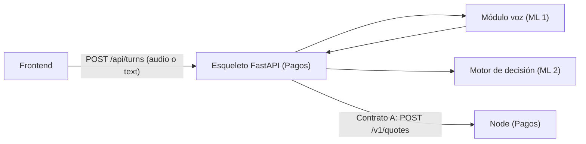

# Contrato del módulo de voz (ML 1)

Fecha: 2026-10-15 · Borrador de ML 1 para el equipo. **No cambia los Contratos HTTP v1**: describe la interfaz
*interna* entre el módulo de voz y el esqueleto FastAPI (Pagos) y el motor de decisión (ML 2), y cómo sus datos
alimentan los Contratos A y B. Es diseño, sin código.

Estado de cada decisión que lo afecta: se marca **[ACORDADO]** si ya lo decidió ML 1, **[PROPUESTA]** si
necesita el OK del equipo, y siempre trae un **valor por defecto** para arrancar el viernes aunque no haya
respuesta. Como el módulo son funciones puras, cambiar una decisión solo toca esa función.

## 1. Dónde encaja



El módulo **no** habla HTTP, no llama a Node y no guarda el estado de la conversación: recibe datos y
devuelve datos. El estado (intención pendiente, `options` ofrecidas, `quoteId`) lo guarda el esqueleto.

Ubicación propuesta en el repo del evento: `api/voice/` **[PROPUESTA]**, según Spec general §8.

## 2. Qué hace el módulo en cada estado del turno

| Estado de entrada (`TurnState`) | Entrada del usuario | Funciones de ML 1 que se usan | Quién decide lo siguiente |
|---|---|---|---|
| `AWAITING_COMMAND` | `audio` o `text` | `transcribe` (si es audio) → `extract_intent` → `resolve_recipient` | ML 2 (motor) y Pagos (cotizar) |
| `AWAITING_CONFIRMATION` | `audio` o `text` | `transcribe` → `classify_reply` | ML 2 |
| `AWAITING_RECIPIENT_CHOICE` | `text` con `alias`, o `audio` | `resolve_choice` | Pagos |
| `AWAITING_PIN` | `text` (el PIN) | **Ninguna.** El PIN no pasa por el módulo (V-24) | ML 2 |
| `AWAITING_AUTHORIZATION`, `COMPLETED`, `REJECTED` | — | `say` (solo el texto) | Pagos |

## 3. Tipos

Descripción en TypeScript solo para que sea legible; la implementación es en Python con los mismos campos.

```ts
type Amount = { value: string; assetCode: string; assetScale: number }   // CONV-1, sin float

type AssetConfig = { assetCode: string; assetScale: number }             // MVP: COP y 2 (V-17)

type Transcript = {
  text: string            // vacío si no hubo habla
  hadSpeech: boolean      // false si el filtro local no encontró voz
  engine: "groq" | "local" | "none"
}

type AmountError = "TOO_MANY_DECIMALS" | "AMBIGUOUS_AMOUNT" | "INVALID_AMOUNT"   // internos, no HTTP
type AmountResult = { ok: true; amount: Amount } | { ok: false; code: AmountError }

type Intent = {
  action: "PAY" | "CANCEL" | "UNKNOWN"
  amount: Amount | null
  amountError: AmountError | null        // si el monto dicho no se pudo convertir
  recipient: string | null               // texto dicho, nunca una wallet
  status: "OK" | "AMBIGUOUS" | "UNCLEAR"
}

type Contact = { alias: string; name: string; walletAddress: string; previouslyPaid: boolean }
type Option = { alias: string; name: string }                            // lo único que ve el frontend
type Resolution =
  | { kind: "RESOLVED"; contact: Contact }
  | { kind: "CHOICE"; options: Option[] }                                // ambigua o aproximada única
  | { kind: "NOT_FOUND" }
  | { kind: "UNCLEAR" }                                                  // solo en resolve_choice

type Reply = "YES" | "NO" | "UNCLEAR"
```

## 4. Funciones

| Función | Entrada | Salida | Errores y reglas | Spec |
|---|---|---|---|---|
| `transcribe` | Audio del navegador (WebM/Opus) ya decodificado a PCM float32 16 kHz mono, `requestId`, `consentExterno: bool` | `Transcript` | Tope de **30 s leído de la cabecera antes de decodificar** (ML 2: la RAM crece ~10 MB por segundo de audio); filtro de voz **local y previo**; sin voz no llama a ningún motor. Con consentimiento: Groq `whisper-large-v3-turbo`; sin él, o ante 429 o fallo: local `base` | `speech-transcription` |
| `parse_amount` | texto, `AssetConfig` | `AmountResult` | Regla es-CO: punto de miles solo con 3 dígitos detrás, coma decimal; resto ambiguo | `amount-parsing` |
| `format_amount` | `Amount` | texto "20.000" o "10,50" | Sin float; ida y vuelta con `parse_amount` | `amount-parsing` |
| `extract_intent` | transcripción, `AssetConfig` | `Intent` | Reglas primero; el LLM (`openai/gpt-oss-20b`) solo ubica campos cuando las reglas no alcanzan; `parse_amount` fija el monto; salida del LLM validada con esquema cerrado; fallo del LLM → `UNCLEAR`. Todo `status` distinto de `OK` es "no pagar" | `intent-extraction` |
| `resolve_recipient` | texto del destinatario, agenda | `Resolution` | Exacta normalizada → `RESOLVED`; ambigua o aproximada única → `CHOICE`; sin parecido → `NOT_FOUND` | `contact-resolution` |
| `resolve_choice` | texto o `alias`, `Option[]` ofrecidas, agenda | `Resolution` | Solo entre las opciones ofrecidas; si no, `UNCLEAR` | `contact-resolution` |
| `classify_reply` | texto | `Reply` | Determinístico, sin LLM; cualquier monto o destinatario nuevo → `UNCLEAR` | `reply-classification` |
| `say` | situación, parámetros | texto en español | Catálogo de la sección 7 | `amount-parsing` (confirmación) |

Decodificar el audio del navegador (WebM/Opus) a PCM en memoria (V-08, D8) lo hace una función de ML 1:
Frontend y ML 2 ya cuentan con eso (16 oct), y ML 2 espera PCM float32 16 kHz mono para SpeechBrain. Se puede hacer
con PyAV, que ya instala `faster-whisper`, sin ffmpeg ni archivos temporales **[VERIFICAR]** con la muestra real.

## 5. Cómo alimenta los Contratos A y B

| Dato de ML 1 | Va a | Campo |
|---|---|---|
| `Intent.amount` | Contrato A `POST /v1/quotes` | `receiveAmount` (lo que recibe el destinatario; DECIDIDO) |
| `Contact.walletAddress` | Contrato A `POST /v1/quotes` | `receiver` |
| `Resolution.options` | Contrato B `TurnResponse` | `options` (solo `alias` y `name`, nunca la wallet) |
| `say(...)` | Contrato B `TurnResponse` | `say` |
| `Transcript.text` | Contrato B `TurnResponse` | `transcript` (se muestra en pantalla; no va a logs, PRIV-4) |
| `Transcript.hadSpeech = false` | Contrato B | `state: AWAITING_COMMAND` + `say` de "no te escuché" |

Los errores de monto (`TOO_MANY_DECIMALS`, etc.) **no** son errores HTTP: el esqueleto responde `TurnResponse`
en `AWAITING_COMMAND` con el `say` correspondiente **[PROPUESTA, D6]**.

## 6. Valores por defecto si el equipo no responde a tiempo

| Decisión | Por defecto el viernes |
|---|---|
| D3 formato de montos | Regla es-CO de la sección 4; la jerga ("luca", "barra") queda **fuera** hasta validarla |
| D4 forma de la intención | El tipo `Intent` de arriba |
| D5 sí/no y "nuevo" | `classify_reply` de ML 1 con la lista de la sección 8; "nuevo" = `previouslyPaid` en falso; Laura sembrada en verdadero |
| D6 Contrato B | Los errores y la elección por `text` del documento de revisión (C-6); el módulo no depende de HTTP |
| D7 batería | Solo texto en el repo; audios fuera |
| D8 carga | ML 1 hace `say` y el decodificado; H1 sin ayudar al esqueleto |
| V-16 cifra en la confirmación | **Antes del "sí": solo lo que recibe el destinatario y su nombre** ("¿Le envío 20.000 pesos a Laura?"). El costo, si el débito difiere, se dice **después** de `COMPLETED`. Es la propuesta D-3 de Pagos, aceptada por ML 2 (16 oct); el Frontend (F-4) pide que se cierre |

## 7. Catálogo de `say` (español, tuteo, sin género)

| Situación | Texto | Estado resultante |
|---|---|---|
| `NO_SPEECH` | "No te escuché. ¿Me lo repites?" | `AWAITING_COMMAND` |
| `NOT_UNDERSTOOD` | "No te entendí. ¿Me lo repites?" | `AWAITING_COMMAND` |
| `AMOUNT_MISSING` | "¿Cuánto quieres enviar?" | `AWAITING_COMMAND` |
| `RECIPIENT_MISSING` | "¿A quién se lo envío?" | `AWAITING_COMMAND` |
| `AMOUNT_AMBIGUOUS` | "No me quedó claro el monto. ¿Me lo dices otra vez?" | `AWAITING_COMMAND` |
| `TOO_MANY_DECIMALS` | "Solo puedo enviar montos con hasta {n} decimales. ¿Me lo dices otra vez?" | `AWAITING_COMMAND` |
| `INVALID_AMOUNT` | "Ese monto no es válido. ¿Cuánto quieres enviar?" | `AWAITING_COMMAND` |
| `NOT_FOUND` | "No encontré a {destinatario} en tu agenda." | `AWAITING_COMMAND` |
| `CHOICE` | "¿A cuál? {opción1} o {opción2}." | `AWAITING_RECIPIENT_CHOICE` |
| `NEAR` | "¿Quisiste decir {nombre}?" | `AWAITING_RECIPIENT_CHOICE` |
| `CONFIRM` | "¿Le envío {recibe} pesos a {nombre}?" | `AWAITING_CONFIRMATION` |
| `CONFIRM_UNCLEAR` | "No te entendí. ¿Le envío {recibe} pesos a {nombre}? Di sí o no." | `AWAITING_CONFIRMATION` |
| `CANCELLED` | "Listo, cancelé el envío." | `REJECTED` |
| `COMPLETED` | "Listo, le envié {recibe} pesos a {nombre}." Si el débito difiere: "…Te costó {costo} pesos." | `COMPLETED` |
| `PAYMENT_PENDING` *(propuesto por Pagos)* | "Tu envío está en camino. No hace falta repetirlo." | `PAYMENT_PENDING` |
| `PIN_KEYBOARD` | "Escribe tu PIN en el teclado." (nunca repite dígitos) | `AWAITING_PIN` |
| `AUTH_BUDGET` | "Para empezar, autoriza tu presupuesto en tu billetera. Toca el botón que dice Aprobar." | `AWAITING_AUTHORIZATION` |
| `AUTH_OVERRUN` | "Supera tu presupuesto. ¿Lo autorizas en tu billetera?" | `AWAITING_CONFIRMATION` |
| `AUTH_REDIRECT` | "Te voy a llevar a tu billetera. Toca el botón que dice Aprobar." | `AWAITING_AUTHORIZATION` |
| `AUTH_APPROVED` / `AUTH_REJECTED` | "Listo, autorizaste el pago." / "No autorizaste el pago. No envié nada." | según el resultado |

Los `say` salen siempre de **plantillas**, nunca de un LLM (spec de Pagos `turn-orchestration`: Pagos define qué
información lleva cada estado y ML 1 escribe las frases; tuteo: "toca", no "tocá"). Las frases de exceso de
presupuesto, del PIN y de la wallet son propuestas de ML 1: Pagos y ML 2 deciden qué información lleva
cada una y pueden ajustarlas. **[VERIFICAR]** con el Frontend cómo lee el TTS del navegador "20.000":
debería decir "veinte mil".

## 8. Lista cerrada de afirmativos **[PROPUESTA, D5]**

Se compara sin tildes ni mayúsculas ni puntuación. La respuesta es `YES` solo si **todas** sus palabras
pertenecen a las permitidas y hay al menos una afirmación.

- **Afirmaciones:** "si", "confirmo", "dale", "claro que si", "si claro", "si por favor", "de acuerdo".
- **Rellenos permitidos:** "por favor", "gracias", repeticiones ("si si").
- **Excluidas a propósito:** "claro" suelto, "bueno", "ok", "listo", "ajá", "mmm", "vale", "va". Son ambiguas
  ("claro… pero no", "listo" como "ya terminé"). Si el equipo quiere alguna, que lo decida con el riesgo a la vista.
- **Negaciones:** "no", "nada", "cancela", "cancelar", "para", "detente". Una respuesta con afirmación y
  negación a la vez es `UNCLEAR`.

## 9. Lo que ML 1 necesita de los demás, y para cuándo

| De | Qué | Cuándo |
|---|---|---|
| Todos | OK a D4, D3 y D6 (o aceptar los valores por defecto) | Arranque, 10:30 |
| Pagos | Wallet addresses de la demo, y la ruta donde se importa `api/voice/` | H1 |
| Pagos | PCM ya decodificado (o aceptar la función de decodificado de ML 1) | H2 |
| Frontend | Muestra real de audio del navegador; grabar solo cuando termine el TTS; `text` = `alias` en la elección | H2 |
| ML 2 | Texto de consentimiento del proveedor externo; consumir `Intent` y `Reply`; el motor aplica SEG-6 con `previouslyPaid` | H1 y H2 |

## 10. Lo que ML 1 entrega, y para cuándo

| Hito | Entrega |
|---|---|
| **H1** (vie 14:00) | `parse_amount`, `format_amount`, `resolve_recipient`, `resolve_choice`, `extract_intent`, `classify_reply` y `say`, con pruebas de los escenarios de los specs, como paquete sin HTTP |
| **H2** (vie 17:30) | `transcribe` (filtro local, Groq y respaldo local) integrado al esqueleto, y la batería de frases de desarrollo corriendo |
| **H3** (sáb 09:30) | Batería con ruido; coincidencia aproximada afinada |
| **H4** (sáb 10:30) | Pulido de frases y de `say`; congelar a las 10:00 |
