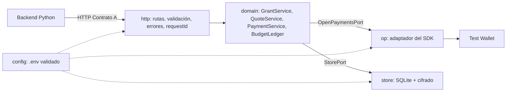

# Design — Microservicio de pagos (Node/TS)

## Context

Ver `proposal.md` (Why). La interfaz con Python está fijada por el Contrato A
(`docs/contratos-http-v1.md`) y los comportamientos observables por
`specs/payments-service/spec.md`. Este documento explica **cómo** se cumplen.

Restricciones:
- Todo el código se escribe en el evento (16–17 oct), y la IA lo escribe a partir de este diseño.
- Unas 13 h netas para todo el equipo. Este servicio tiene que estar listo para el hito H1
  (viernes 14:00).
- La Test Wallet de Interledger es el único proveedor de cuentas.
- Referencias de código: `interledger/testnet` → `packages/boutique` (`setupOneClick`,
  `continueGrant`, `instantBuy`) y `interledger/open-payments-workshop`.

## Goals / Non-Goals

**Goals:**
- Que un reinicio del proceso en plena demo no obligue a volver a autorizar.
- Que ningún reintento pague dos veces.
- Que el SDK de Open Payments esté aislado en un solo módulo, para poder probar todo lo demás sin red.
- Que la latencia de quote y pago sea medible por cada llamada a Open Payments.

**Non-Goals:**
- Multiusuario, autenticación entre servicios, HTTPS interno.
- Cancelaciones, reembolsos y conversión de moneda en la interfaz.
- Alta disponibilidad: hay una sola instancia en una laptop.

## Decisions

### D1 — Base del proyecto: `hackathon-backend-example`, con Express desde cero como plan B
Repo oficial de Interledger para hackathons: Express + TypeScript, Node 24, preparado para el
callback del grant. Ahorra unos 30 min de armado.
- *Alternativa:* Fastify desde cero, que trae validación de esquemas integrada. Se descartó
  porque obliga a arrancar sin una referencia oficial bajo presión.
- *Pendiente:* confirmar con la organización que usar el repo base no cuenta como "código previo".
  Si no se puede, Express desde cero; el diseño no cambia. Su licencia se declara en el README y
  en `AI_USAGE.md`.

### D2 — Arquitectura hexagonal con el SDK aislado

| Módulo | Responsabilidad | Regla |
|---|---|---|
| `http` | Rutas, validación de entrada, formato de error, `requestId`, log por request | No conoce Open Payments |
| `domain` | Reglas: estados, presupuesto, idempotencia, traducción de errores | Depende solo de puertos |
| `op` | Llamadas al SDK; traduce sus errores a errores de dominio | **Único** módulo que importa `@interledger/open-payments` |
| `store` | Repositorios SQLite y cifrado de tokens | **Único** módulo que toca `node:sqlite` |
| `config` | Lee y valida `.env` al arrancar | Si algo falta, no arranca |

- *Por qué:* `domain` se prueba contra un Open Payments falso, en milisegundos y sin red. Solo
  dos pruebas de humo tocan la Test Wallet.
- *Alternativa:* llamar al SDK directo desde las rutas, como hace el workshop. Es más rápido
  de escribir, pero no se puede probar sin red y mezcla HTTP con reglas de negocio.

### D3 — Persistencia en SQLite con `node:sqlite`, modo WAL
- *Por qué:* hace que se cumplan "Supervivencia a reinicios" y "Tokens cifrados en reposo" sin
  dependencias nuevas, porque viene con Node 24.
- *Alternativa:* un `Map` en memoria. Se descartó porque cualquier reinicio pierde el grant y las
  claves de idempotencia, y no hay nada que cifrar.

| Tabla | Campos |
|---|---|
| `grants` | `id`, `user_id`, `wallet_address`, `grant_endpoint_uri`, `status`, `limit`, `client_nonce`, `interact_nonce`, `continue_uri`, `continue_token`🔒, `access_token`🔒, `manage_url`, `created_at`, `activated_at` |
| `quotes` | `id`, `grant_id`, `op_quote_url`, `receiver`, `debit_amount`, `receive_amount`, `expires_at`, `status` |
| `payments` | `id`, `grant_id`, `quote_id`, `op_payment_url`, `debit_amount`, `sent_amount`, `status`, `created_at` |
| `idempotency_keys` | `key` (PK), `quote_id`, `state` (`RESERVED` \| `SENT` \| `UNKNOWN` \| `DONE`), `response`, `created_at` |
| `token_cache` | `auth_server`, `kind` (`incoming-payment` \| `quote`), `token`🔒, `expires_at` |

🔒 = AES-256-GCM con IV aleatorio por valor; la llave sale de `DB_ENCRYPTION_KEY`.

### D4 — Qué hace cada endpoint por dentro

| Endpoint | Pasos |
|---|---|
| `POST /grants` | Validar montos → `walletAddress.get(usuario)` → generar `clientNonce` → `grant.request` interactivo (`limits`, `finish{uri, nonce}`) contra `authServer` → guardar todo, incluido `grant_endpoint_uri` **exactamente** como se usó → devolver `interact.redirect` |
| `POST /grants/{id}/continue` | Cargar el grant (debe estar PENDING y no vencido) → verificar el hash localmente → `grant.continue` → guardar el access token y la `manage` URL → marcar ACTIVE (los otros ACTIVE del usuario no se tocan) |
| `DELETE /grants/{id}` | Cargar el grant (ya `EXPIRED` por cancelación → `204` idempotente; desconocido → `404`) → `grant.cancel` con la `manage` URL guardada → marcar `EXPIRED` aunque el cancel falle (al cliente `502`) |
| `GET /grants/{id}` | Leer el grant → aplicar los vencimientos → calcular `spent`/`remaining` con `BudgetLedger` |
| `POST /quotes` | Validar montos y que el grant esté ACTIVE → `walletAddress.get(receptor)` → comparar asset → token de incoming payment (del caché o con un grant no interactivo) → `incomingPayment.create` (⚙️ con `expiresAt` a 10 min, porque lo fija el cliente y tiene que superar los 5 min de la quote) → token de quote (del caché o con un grant no interactivo) → `quote.create` → guardar → `exceedsRemaining` |
| `POST /payments` | Header → reservar la clave (ver D5) → la quote existe, está CREATED y no vencida → grant ACTIVE → presupuesto local → `token.rotate` y **guardar el token nuevo** → `outgoingPayment.create` → guardar el pago y marcar la quote USED → guardar la respuesta en la clave |
| `GET /payments/{id}` | Leer el pago → `outgoingPayment.get` (con un reintento si falla) → derivar el estado → actualizar `sent_amount` |

### D5 — Idempotencia con reserva antes del primer `await`
La clave pasa por estas fases: `RESERVED` → `SENT` → `DONE`, más `UNKNOWN` si el resultado es incierto.

1. **Reservar (`RESERVED`):** `INSERT` de la clave con su `quote_id`. `node:sqlite` es síncrono y
   la clave es primaria, así que la reserva ocurre antes de cualquier `await` y dos requests
   concurrentes no pueden reservar la misma clave (verificado en Node v24.20.0: el duplicado lanza
   `ERR_SQLITE_ERROR`).
2. **Si la clave ya existe:** con otro `quote_id` → `422 IDEMPOTENCY_KEY_REUSED`; en `DONE` → se
   devuelve la respuesta guardada; en `RESERVED`/`SENT` → se consulta cada 100 ms durante un máximo de 2 s y, si sigue igual,
   `409 PAYMENT_IN_PROGRESS`; en `UNKNOWN` → se resuelve (paso 5).
3. **Antes de crear el pago (`SENT`):** en **una sola transacción**, la clave pasa a `SENT` y la
   quote a `USED`. Desde ahí, ninguna otra clave puede pagar esa quote (`404 QUOTE_NOT_FOUND`).
4. **Al terminar:** si `outgoingPayment.create` responde, se guarda la respuesta (también los 4xx)
   y la clave pasa a `DONE`. Si responde con timeout o error de red, la clave pasa a `UNKNOWN`
   y el cliente recibe `502 UPSTREAM_ERROR`. Si falla **antes** de `SENT`, la clave se borra
   para permitir el reintento.
5. **Resolver `UNKNOWN`:** se busca en Open Payments un outgoing payment de la wallet creado con esa
   quote (`outgoingPayment.list` filtrando por `quoteId`). Si existe → se guarda y la clave pasa a
   `DONE` con `201`. Si no existe → se reintenta el `create` **una sola vez**. Nunca se reintenta a
   ciegas sin buscar antes.
6. **Al arrancar:** las claves en `RESERVED` se borran (su pago nunca se envió); las que están en
   `SENT` pasan a `UNKNOWN`.

- *Evidencia:* M0-EJ4 (la versión ingenua hizo 2 pagos; la versión con reserva, 1).
- *Regla para Python:* ante un `502` o un `409 PAYMENT_IN_PROGRESS` de `/payments`, reintentar
  con **la misma clave**, nunca con una nueva.
- *[VERIFICAR] en E2/E3:* ¿el servidor rechaza un segundo outgoing payment creado con la misma
  quote? Si lo rechaza, el reintento del paso 5 es seguro aunque falle la búsqueda.

### D6 — Rotación del token: preventiva y ante un `401`
*Evidencia (E4, 2026-10-12):* los tres tipos de grant (incoming payment, quote y outgoing payment
interactivo) traen `access_token.expires_in = 600` s. El grant de la demo **va a** vencer durante
la presentación, así que la rotación es obligatoria.
- *Política:* se rota si al token le quedan menos de 60 s, y también ante un `401` (con un solo
  reintento). Ahorra una llamada por pago frente a rotar siempre (patrón Boutique).
- `token.rotate` invalida el token anterior, así que el nuevo se guarda **antes** de usarlo.
- *Riesgo aceptado:* si el proceso cae entre la respuesta de `rotate` y el guardado, el grant
  queda inutilizable y toca reautorizar.
- *[VERIFICAR] en E4:* `token.rotate` en la Test Wallet, incluido rotar un token ya vencido (por
  ejemplo, después de un reinicio largo).

### D7 — Chequeos locales antes de llamar a Open Payments
Quote vencida y presupuesto excedido se detectan localmente. Es más rápido y no depende del texto
de los errores del servidor. El error real de Open Payments queda como segunda red y se traduce
con la tabla de D8.

### D8 — Traducción de errores (la implementa el módulo `op`)

*Evidencia (E2/E3, 2026-10-12):* los errores del SDK traen `status`, `code` (el status como texto)
y `description`, sin códigos de dominio. Por eso la traducción se basa en el **contexto local** y no
en el texto del error.

| Situación | Lo que devuelve la Test Wallet | Código |
|---|---|---|
| Wallet del usuario no se resuelve | — | `400 INVALID_WALLET` |
| Wallet del receptor no se resuelve o el asset no coincide | — | `400 INVALID_RECEIVER` |
| Quote vencida (detectada con el `expiresAt` local) | No se llama | `409 QUOTE_EXPIRED` |
| `outgoingPayment.create` rechaza la quote | `400 "invalid quote"` (vencida o inexistente, no los distingue) | `409 QUOTE_EXPIRED` (no se creó el pago, así que recotizar es seguro) |
| Pago fuera del tope (detectado localmente) | No se llama | `403 LIMIT_EXCEEDED` |
| `outgoingPayment.create` responde `403` | `403 "unauthorized"`, igual para tope agotado, pago mayor al tope o grant inválido | Se recalcula el gastado: no entra → `403 LIMIT_EXCEEDED`; entra → `401 GRANT_INVALID` |
| `401` | — | Rotar y reintentar una vez; si falla, `401 GRANT_INVALID` |
| Usuario rechazó la interacción | [VERIFICAR] E3 | `403 GRANT_REJECTED` |
| Timeout, error de red o 5xx | Se vieron un timeout y un `fetch failed` transitorios | `502 UPSTREAM_ERROR` |
| Cualquier otro | — | `500 INTERNAL_ERROR` |

### D9 — Caché de tokens no interactivos
Los tokens de incoming payment (por auth server del receptor) y de quote se reutilizan hasta
`expires_at` menos 30 s. Esto le ahorra 2 llamadas a cada quote, que importa porque la voz no
tolera esperas largas.

### D12 — Fuente del `spent`: primero el servidor, el cálculo local como respaldo
`outgoingPayment.getGrantSpentAmounts({ url, accessToken })` devuelve `spentDebitAmount` y
`spentReceiveAmount` del período vigente del grant.
- *Evidencia (E3, 2026-10-12):* funciona en la Test Wallet. Después de pagar 25000 con un tope de 25000
  devolvió `spentDebitAmount = { value: "25000", assetCode: "COP", assetScale: 2 }`, con el mismo
  formato que el resto de los montos. Además, **la quote no valida el tope**: se creó una de 25000
  con un tope de 12500. El chequeo antes de pagar es imprescindible.
- `GET /grants` y el chequeo de presupuesto usan `spentDebitAmount`. Si esa consulta falla, se usa
  la suma local (pagos PROCESSING y COMPLETED del período).
- `exceedsRemaining` y el chequeo se comparan contra el `debitAmount` de la quote.
- *[VERIFICAR]:* el desfase entre `create` y que el servidor refleje el pago, consultando sin polling.
- *Regla determinística:* `spent = max(valor del servidor, suma local)`. Así un pago recién creado
  que el servidor todavía no refleja cuenta igual, y ningún pago se cuenta dos veces.

### D10 — Montos con `BigInt`
Toda la suma y comparación se hace con `BigInt` sobre `value`. Dos montos con distinto
`assetCode`/`assetScale` nunca se combinan: es un error interno (`500`), porque significa un bug.
- *Evidencia:* M0-EJ2 (`0.1 + 0.2`, `19.99 * 100` y `1.005 * 100` fallan con `number`).

### D11 — Configuración

| Variable | Uso |
|---|---|
| `WALLET_ADDRESS` | Wallet de la usuaria de la demo (cliente de Open Payments) |
| `KEY_ID`, `PRIVATE_KEY_PATH` | Llaves de desarrollador; la llave privada vive fuera del repo |
| `DB_ENCRYPTION_KEY` | 32 bytes en base64 para AES-256-GCM |
| `PORT` (por defecto 4000), `DB_PATH` | Operación |
| `OP_TIMEOUT_MS` | Timeout por llamada a Open Payments. El default del SDK (5 s) dio un timeout transitorio en E0–E4; ⚙️ partir de 8 s y ajustar con los tiempos medidos |

Se versiona solo `.env.example`. Hay un script (no un endpoint) que borra la base de datos para
preparar la demo.

### D13 — El exceso de límite usa un grant puntual semanal
Python maneja dos tipos de grant: el **grant de presupuesto** (autorizado una vez) y un
**grant puntual** para un pago que excede lo restante, con tope igual al `debitAmount` de
la quote que excedió e `interval` semanal de una sola repetición (`R1/<hoy 00:00:00Z>/P1W`,
decisión #1 del 16 oct). Node no necesita distinguirlos: ambos son grants del Contrato A,
y `/quotes` y `/payments` ya reciben el `grantId` que Python decide pasar.
- *Por qué:* el grant de presupuesto sigue `ACTIVE` durante y después del pago puntual, así que
  la usuaria no pierde lo que le quedaba del presupuesto (tramo 2:30–2:50 del guion, Spec
  general §3).
- *Alternativa descartada:* ampliar el grant de presupuesto a `max(límite original, monto)`
  dejaba el restante en 0 y borraba el presupuesto autorizado una sola vez.
- *Ciclo de vida:* el grant puntual **vence por semana**: se pide con `limits.interval`
  `R1/<inicio>/P1W` y el servicio lo vence por su cuenta con `load()` + `currentPeriod` cuando
  se agota la repetición. Si el equipo confirma la cancelación al usarse (decisión pendiente),
  sigue disponible `DELETE /v1/grants/{grantId}` (A-1).
- *Evidencia de los experimentos del 17 oct (`payments/experiments/*.md`):*
  (i) la Test Wallet **acepta** `R1/<inicio>/P1W` junto con `debitAmount` y lo devuelve en el
  grant (`weekly-interval-and-token.md`, sección P1); el vencimiento real a 7 días no es
  observable, así que el servicio lo hace cumplir por su cuenta;
  (ii) con el access token vencido la wallet responde **403, no 401**: por eso el servicio rota
  el token una vez ante un 403 cuyo monto entra en lo que queda (D-14a) y reintenta
  (`weekly-interval-and-token.md`, sección P4);
  (iii) `getGrantSpentAmounts` devuelve `spentDebitAmount` **nulo** antes del primer pago: se
  trata como 0 y rige la suma local (`weekly-interval-and-token.md`, sección P5);
  (iv) verificado en la Test Wallet: `token.revoke` sobre la manage URL y `grant.cancel` sobre
  la continue URI dejan el access token inusable (403 en lectura), así que la cancelación de
  A-1 está cubierta con `token.revoke` (`cancel-grant.md`; resuelve el [VERIFICAR] del
  adaptador).
- *Requisito del lado Node:* "Varios grants activos por usuario", "Cancelación de un grant" y
  el escenario de 403 con token vencido en `specs/payments-service/spec.md`.

## Risks / Trade-offs

- [El rechazo en la wallet no vuelve con `interact_ref` + `hash`] → El Contrato B se propone con
  `interactRef`, `hash` y `result` opcionales para cubrir cualquier forma del redirect (cambio
  propuesto en `add-payments-client`); el experimento E3-rechazo confirma cuál es la forma real.
- [`limits.interval` no funciona en la Test Wallet] → El MVP usa tope total; el contrato ya lo admite.
- [El servidor tarda en reflejar un pago en `getGrantSpentAmounts`] → `spent = max(servidor, suma
  local)` evita que dos pagos seguidos se salteen el chequeo.
- [Los 403 del servidor no explican el motivo] → Chequeo local antes de pagar y recálculo del
  gastado después del 403 (D8).
- [La rotación del token deja el grant inutilizable si el proceso cae a mitad de camino] →
  La ventana es de milisegundos; el plan B es reautorizar, que igual es el momento estrella
  de la demo.
- [La cadena de 4–6 llamadas en `POST /quotes` es lenta para la voz] → Caché D9 y log de
  duración por llamada para encontrar el cuello de botella.
- [La organización no permite `hackathon-backend-example`] → Express desde cero; el diseño
  no cambia.

## Migration Plan

No hay nada que migrar. Para la demo: correr el script de borrado de la base de datos → arrancar →
`GET /v1/health` → crear el grant de la demo al comienzo de la presentación.

## Open Questions

Resueltas el 2026-10-12: la quote dura 5 min (2 muestras), los tokens duran 600 s y COP existe con
escala 2 (wallet receptora de prueba).

- ¿La wallet emisora de prueba también está en COP con escala 2? La receptora de prueba ya está confirmada. Solo cambia el `assetCode`.
- ¿Una tercera muestra de E2 confirma los 5 min? No cambia el diseño.
