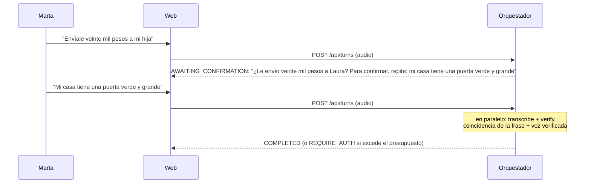

# Confirmación con desafío de voz (banco de frases)

**Estado: [DECIDIDO 2026-10-17]**, aprobada por los cuatro en reunión presencial. Propuesta de ML 2
(Daniel). Cambia SEG-2, la decisión D4 y specs de Pagos, Voz y Frontend; cada rol actualiza su spec
(ver "Impacto por documento y rol"). Quedan abiertas las preguntas 2 y 3 de "Qué se decide".

## El problema (evidencia)

En el experimento X-4 (17 oct) se grabó con un celular a Daniel diciendo "Envíale veinte mil a mi
hija" y se reprodujo frente al micrófono: **1 de 3 reproducciones pasó como `VERIFIED`** (0.506 con
umbral 0.45). Hoy, con voz verificada, destinatario conocido y monto bajo 100.000 COP, el pago solo
pide un "sí". Es decir: **quien tenga una grabación de Marta diciendo un comando y un "sí" puede**
**mover dinero** dentro del presupuesto, sin PIN.

La verificación de hablante no distingue una voz en vivo de una grabación. Lo que sí la distingue es
pedir, en ese momento, una frase que la grabación no puede contener.

## La propuesta

**La confirmación de un pago pedido por voz deja de ser "sí": el sistema dice el monto y el**
**destinatario, como hoy, y pide repetir una frase elegida al azar de un banco.** Se comprueban dos
cosas sobre esa respuesta:

1. **Qué dijo** (Voz): la transcripción coincide con la frase pedida.
2. **Quién lo dijo** (ML 2): la voz coincide con la huella.

<user_quoted_section>"¿Le envío veinte mil pesos a Laura? Para confirmar, repite: mi casa tiene una puerta verde y grande."</user_quoted_section>

### Por qué un banco de frases y no una frase armada con el pago

| Criterio | Banco de frases (elegido) | Frase armada con el pago |
| --- | --- | --- |
| Frena una grabación | Sí: con 30 frases o más, la frase no se puede adivinar | Sí, solo si se le agrega una palabra al azar |
| Errores de transcripción | Pocos: sin nombres ni números | Más: nombres ("Laura" ⇒ "la hora" con el motor local) y montos en cifras o palabras |
| Coincidencia | Comparación de texto simple | Extractor de intención más la palabra al azar |
| Verificación de voz | Duración controlada (~3 s) | Duración variable |
| Consentimiento | El sistema dice el monto y el destinatario antes (SEG-2) | Marta dice el monto y el destinatario |
| Esfuerzo | Bajo | Medio |

### Reglas del banco de frases

- **Al menos 30 frases**, de **6 a 9 palabras** (unos 3 s de voz), cotidianas y fáciles de repetir de
oído (Marta no necesita leerlas: la web las lee en voz alta y las muestra).
- **Sin nombres propios ni números**, para que la transcripción no se equivoque.
- **Sin palabras que el clasificador de respuestas trate como afirmación o negación** ("sí", "no",
"confirmo", "dale", "claro", "listo", "nada", "cancela", "para", "detente"), sin verbos de pago
("envía", "manda", "paga", "pasa", "transfiere", "consigna") y sin palabras de monto ("mil", "pesos",
"un").
- **Distintas de las 3 frases del registro de voz**, que pudieron haberse grabado.
- El backend **elige la frase al azar** (nunca el LLM) y **no repite la misma** en confirmaciones
seguidas de la misma sesión.
- El banco vive en el catálogo de Voz y se puede ampliar sin cambiar código.

### Coincidencia de la frase (80 %)

- Se normalizan la transcripción y la frase esperada (sin tildes, mayúsculas ni signos) y se compara
palabra por palabra.
- **La frase coincide si al menos el 80 % de sus palabras aparecen en la transcripción en orden**
(por ejemplo, con 1 − tasa de error por palabra ≥ 0,80). Eso tolera un error de transcripción en
frases de 6 a 9 palabras. El valor exacto se confirma con un experimento corto.

### Cómo se evalúa la respuesta

| Resultado | Qué pasa |
| --- | --- |
| La frase coincide (≥ 80 %) **y** la voz es `VERIFIED` | Se paga (`PAY`), o va a la billetera si excede el presupuesto (`REQUIRE_AUTH`, SEG-5) |
| La frase coincide pero la voz no se verifica (`BELOW_THRESHOLD` o `NOT_AVAILABLE`) | Se pide el PIN (`ASK_PIN`); con el PIN correcto se paga |
| La frase no coincide | Se repite el desafío **una vez** con otra frase del banco; si vuelve a fallar, `REJECT` (como hoy con una respuesta poco clara) |
| Marta dice "no" o "cancela" | `REJECT`, igual que hoy |

### Lo que no cambia

- **Comandos por texto:** siguen pidiendo PIN (D3) y se confirman con el botón "Sí", porque no hay voz
que desafiar. El PIN ya es el segundo factor.
- El sistema sigue diciendo el monto y el destinatario antes de confirmar (SEG-2, B-6).
- El exceso de presupuesto sigue yendo a la billetera (SEG-5), después del desafío.
- La regla 6 (pago pendiente) y la 6b (aviso) no cambian.
- `highAmountThreshold` (100.000 COP) se mantiene como barrera adicional.

## Primer banco de frases (para revisar)

Cada frase tiene de 6 a 9 palabras y cumple las reglas de arriba. Hay que medir su duración dicha por
una persona mayor (objetivo: 3 s o más de voz útil) y descartar las que Whisper transcriba mal.

| # | Frase | Palabras |
| --- | --- | --- |
| 1 | Mi casa tiene una puerta verde y grande. | 8 |
| 2 | El gato duerme tranquilo junto a la ventana. | 8 |
| 3 | Hoy el cielo amaneció azul y despejado. | 7 |
| 4 | Me gusta tomar café caliente en la mañana. | 8 |
| 5 | La panadería de la esquina abre muy temprano. | 8 |
| 6 | El río corre despacio entre las montañas. | 7 |
| 7 | Mi abuela cocina sopa de verduras los domingos. | 8 |
| 8 | Las flores del jardín huelen muy bien. | 7 |
| 9 | El bus llegó lleno a la estación. | 7 |
| 10 | Compré naranjas frescas en la plaza del barrio. | 8 |
| 11 | La lluvia moja las calles del centro. | 7 |
| 12 | El perro juega feliz con su pelota roja. | 8 |
| 13 | Mañana visito el mercado con mi familia. | 7 |
| 14 | La radio suena bajito en la cocina. | 7 |
| 15 | El sol calienta las tejas de la casa. | 8 |
| 16 | Los niños cantan en el patio de la escuela. | 9 |
| 17 | Guardo mis gafas en el cajón de la mesa. | 9 |
| 18 | El viento mueve las hojas del árbol. | 7 |
| 19 | La leche está fría en la nevera. | 7 |
| 20 | Me encanta caminar por el parque en la tarde. | 9 |
| 21 | Las nubes grises anuncian lluvia esta tarde. | 7 |
| 22 | El café colombiano huele muy rico. | 6 |
| 23 | La sopa quedó deliciosa con sal y cebolla. | 8 |
| 24 | Mi sombrero favorito es de color café. | 7 |
| 25 | El tren pasa cerca del puente viejo. | 7 |
| 26 | La luna brilla sobre el techo de la casa. | 9 |
| 27 | Riego las plantas del balcón cada mañana. | 7 |
| 28 | El pan recién horneado huele delicioso. | 6 |
| 29 | Las palomas comen maíz en la plaza. | 7 |
| 30 | Me gusta escuchar música mientras cocino. | 6 |

## Impacto por documento y rol

| Dónde | Dueño | Cambio | ¿Necesita el OK de los cuatro? |
| --- | --- | --- | --- |
| `docs/spec-general.md` SEG-2 y guion de demo §3 | Equipo | La confirmación de un pago por voz es repetir la frase del desafío; el guion cambia "Sí" por la frase | **Sí** |
| `add-team-baseline` / `payment-safety` | Equipo | SEG-2 (escenario "El PIN no reemplaza el sí") y el requisito "Solo se verifica la voz del comando" | **Sí** |
| `docs/decisiones.md` D4 | Equipo | D4 cambia: se verifica la voz de la confirmación cuando es un desafío | **Sí** |
| Contrato B | Equipo | **No cambia el estado** (se reutiliza `AWAITING_CONFIRMATION` y el `say` lleva la frase). Opcional: un campo `confirmMode: "voice" \| "button"` en `TurnResponse` para que la web sepa si mostrar el botón "Sí" | Solo si se agrega el campo |
| `turn-orchestration` | Pagos (Alexander) | Elige la frase al azar por sesión (sin repetir), evalúa la respuesta con `transcribe` y `verify` en paralelo, y rechaza un "sí" por texto cuando la confirmación es por voz | No (es su spec) |
| `add-voice-understanding` | Voz (Sebastián) | El banco de frases en el catálogo, `phrase_match(transcripción, frase) -> puntaje` con el corte del 80 % y los textos nuevos (`CONFIRM_CHALLENGE`, `CHALLENGE_RETRY`) | No (es su spec) |
| `add-decision-engine` | ML 2 (Daniel) | En la fase `CONFIRMATION`: entradas nuevas (coincidencia de la frase y voz de la confirmación) y las reglas de la tabla de arriba, con `reason` nuevos | No (es su spec) |
| `speaker-verification` | ML 2 (Daniel) | La verificación corre también sobre la respuesta al desafío | No |
| `add-voice-web-client` | Frontend (Juan) | Mostrar la frase en pantalla y no mostrar (o no aceptar) el botón "Sí" cuando la confirmación es por voz; el botón "No" se mantiene | No (es su spec), salvo el campo opcional del contrato |

## Riesgos y cómo se manejan

| Riesgo | Mitigación |
| --- | --- |
| **Accesibilidad:** repetir una frase de 7 u 8 palabras cuesta más que decir "sí" para una persona mayor | Frases cotidianas; la web las lee despacio y las muestra; un reintento con otra frase; si falla, PIN o cancelar, nunca un bloqueo |
| **Consentimiento:** repetir una frase neutra no dice qué se paga | El sistema dice antes el monto y el destinatario (SEG-2); la frase va justo después, en el mismo turno |
| **Errores de transcripción** | Frases sin nombres ni números; tolerancia del 80 %; si falla dos veces, cae al PIN |
| **Latencia:** se suma una transcripción y una verificación a la confirmación | Corren en paralelo: ~1 s con Groq, lo mismo que hoy transcribir el "sí" |
| **Plazo:** el código se congela hoy a las 10:45 y el orquestador aún no existe | Implementarlo detrás de una opción de configuración (`confirmationChallenge`, apagada por defecto). Si no está probado antes de la demo, se muestra con "sí" y el desafío se presenta como siguiente paso |
| **Un atacante graba a Marta diciendo frases del banco** | Necesitaría la frase exacta que sale en ese momento entre 30 o más; con un reintento y frase nueva, la probabilidad de acertar al azar es de 1 en 15 o menor, y además tendría que pasar la verificación de voz. El banco se puede ampliar |

## Qué se decide

1. ¿El equipo aprueba que la confirmación por voz sea un desafío con una frase del banco (cambia SEG-2
   y D4)? **Sí: aprobado por los cuatro el 2026-10-17 (presencial).**
2. ¿Se agrega el campo opcional `confirmMode` al Contrato B, o el orquestador simplemente rechaza un
 "sí" por texto en una confirmación por voz?
3. ¿Entra para la demo (detrás de la opción de configuración) o se presenta como siguiente paso?

Aprobada: cada rol escribe su parte en su spec y ML 2 mide con un experimento corto la
coincidencia de la frase (para confirmar el 80 %) y la voz con frases del banco dichas en vivo frente
a una grabación reproducida.
